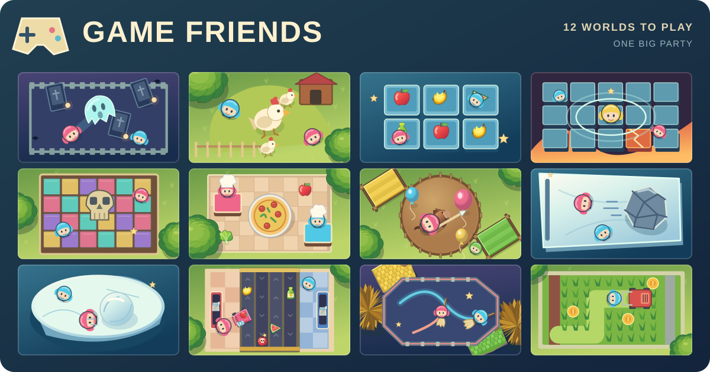
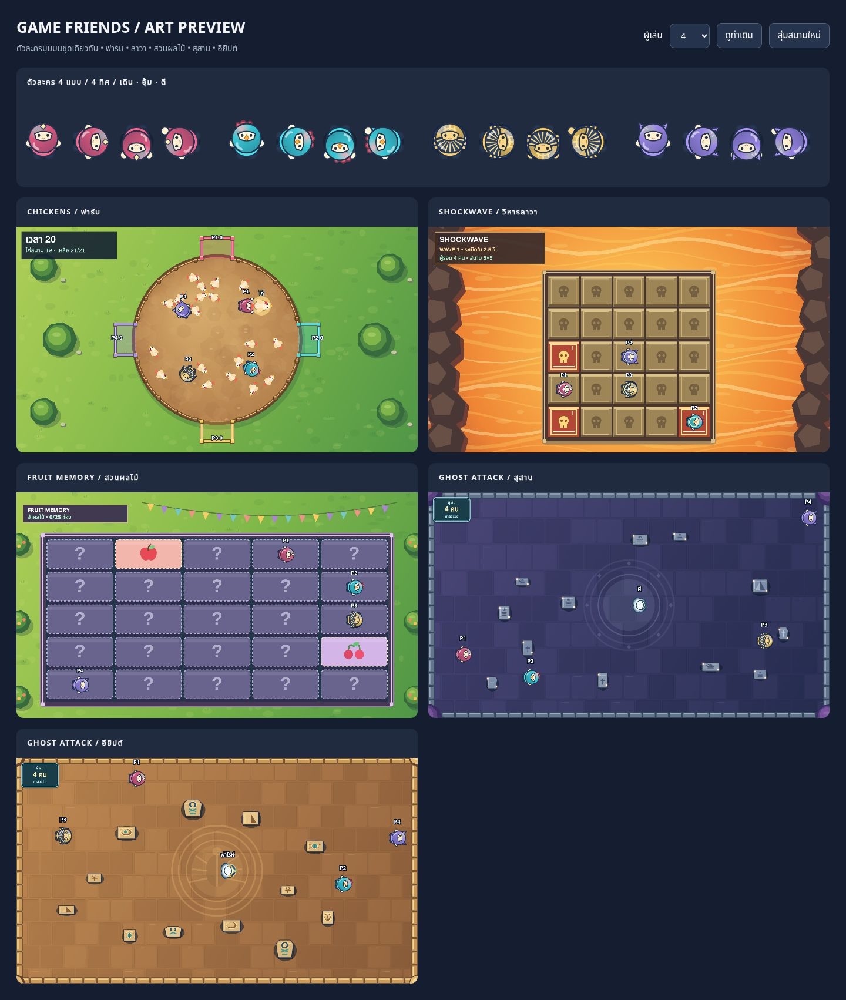

# GAME-FRIENDS — STICK SQUAD PARTY



ภาพปกเกมอยู่ใน `assets/game-friends-cover.svg` พร้อมภาพแชร์ `assets/game-friends-social.png` และไอคอน `assets/game-friends-icon.svg` ใช้จากไฟล์ใน repository โดยตรง

เกมปาร์ตี้เล่นบนเว็บแบบจอใหญ่ + จอยมือถือผ่าน QR Code สูงสุด **12 ผู้เล่น**
มีมินิเกม **GHOST ATTACK**, **CHICKENS**, **FRUIT MEMORY**, **SHOCKWAVE**, **COLOR SWITCH** และ **PIZZA TIME** ใช้ระบบห้อง จอยมือถือ พรีวิวและการแข่งขันเดียวกัน; มินิเกมเก่า STAR RUSH, BRAWL, LAVA RUN, TANKS, FOOTBALL, RALLY และ COLOR CLASH ไม่ได้ถูกนำกลับมา

## BOARD PARTY — Winter Snow Adventure

เพิ่มโหมดกระดานต่อเนื่องแยกจาก **NORMAL PARTY** เลือก **BOARD PARTY • กระดานหิมะ** ในล็อบบี้ได้ทันที รองรับ 1–12 คน ทอยสองลูกกลางจอ ใช้อนาล็อกเดินอิสระภายในช่องและแนวทางเดิน ถอยแก้ทางหรือเลี้ยวกลับไปเลือกกิ่งใหม่ก่อนถึงช่องถัดไปได้โดยไม่เสียก้าว มีตัวนับก้าวป้องกันข้ามช่อง พร้อม **กระเป๋าไอเทมสะสมหลายชิ้น** (B เปิด → A เลือกรวมช่องปิด → B ใช้หรือปิด) รองรับไอเทม 6 ชนิดรวมโล่ และเล่นมินิเกมเดิมเมื่อครบหนึ่งรอบ ผู้เล่นครึ่งบนได้รับไอเทมเข้ากระเป๋าอัตโนมัติก่อนกลับกระดานเดิม โดยเรียงตารอบใหม่ตามอันดับมินิเกม ผู้ถึง FINISH ก่อนชนะ

ดู [วิธีเล่น กติกาไอเทม โครงสร้าง และผลการทดสอบ](docs/board-party.md) หรือรัน `node tests/board-party.cjs` และ `node tests/smoke.cjs`

## นโยบายภาพในเกม: ใช้ SVG เท่านั้น ห้ามใช้อีโมจิ

- ห้ามใส่อีโมจิจากฟอนต์อุปกรณ์ใน HUD, แถบรายชื่อ, ออร์เดอร์, กล่องวัตถุดิบ, จอย, เอฟเฟกต์ หรือส่วนอื่นของเกม
- ใช้ไฟล์ SVG ที่สร้างเองเท่านั้น ไม่ใช้ข้อความเป็นสัญลักษณ์ภาพ รวมถึงดาวและประกาย
- `pizza-ingredient-art.js` เป็นชุด SVG วัตถุดิบ 8 ชนิด ใช้แหล่งเดียวกันกับสนาม PIZZA TIME, แถบคะแนนจอหลัก และจอยมือถือ ไม่มีการแปลงไอคอนเป็นอีโมจิ
- `party-ui-art.js` เป็นชุด SVG สำหรับดาว ประกาย และสถานะ ส่วนไอคอนใน HTML เช่น เต็มจอและสัญลักษณ์แบรนด์เป็น inline SVG
- กล่องออร์เดอร์ของ PIZZA TIME ใช้ `planOrderCards()` เลือกตำแหน่งจากกรอบตัวเชฟและกรอบกล่องอื่น โดยไม่วาดทับตัวเชฟหรือทับกัน แม้มีผู้เล่น 12 คน
- ทดสอบระบบภาพด้วย `node tests/pizza-time.test.cjs` และระบบรวมด้วย `node tests/smoke.cjs` พร้อมตรวจว่าสคริปต์ SVG ทั้งสองไฟล์ถูกระบุใน `scripts/build-static.cjs` ก่อน Deploy เพื่อป้องกัน asset เก่าจากแคช

## ระบบกลางตัวละครและกฎชนกัน (ใช้กับทุกแมพ)

ระบบกลางอยู่ที่ `character-system.js` โหลดหลัง `player-avatar.js` และก่อนมินิเกมทุกตัว โดย `window.PartyCharacters` เป็น API กลางสำหรับตัวละคร การเดิน ทิศทาง ความเร็ว วาดตัวละคร และการชน/ดันกันแบบ host-authoritative

**กฎบังคับสำหรับทุกเกม:** เมื่อไม่ได้ระบุไว้ว่าเดินทะลุกันได้ ตัวละครทุกตัวต้องชนและดันกันได้เป็นค่าเริ่มต้น (รวมบอทด้วย) ต้องไม่คัดลอกหรือสร้างระบบแยกในแต่ละเกม โดยเกมจะส่งเฉพาะค่าขอบสนาม รัศมีตัวละคร กำแพง/สิ่งกีดขวาง และข้อยกเว้นที่กติกากำหนดไว้ให้ระบบกลาง

ตัวอย่างการใช้งานสำหรับมินิเกมใหม่:

```js
const characters = window.PartyCharacters;
characters.activate(players); // เปิดใช้ผู้เล่น/บอทหลังสร้างห้อง
for (const p of players) {
  const direction = p.isBot ? chooseBotMovement(p) : characters.control(p.input);
  characters.move(p, direction, dt, {
    speed: 165, radius: 15, bounds: board
  });
}
characters.resolve(players, {
  radius: 15, bounds: board,
  // Optional: constrain เพื่อคงผนัง โต๊ะ สิ่งกีดขวาง หรือสนามวงกลม
});
for (const p of players) if (p.active) characters.draw(ctx, p, {time:clock});
```

- `characters.resolve(players)` ทำงานโดยตั้งต้น `playersSolid:true` อัตโนมัติ รองรับการเกิดทับตำแหน่งกัน แรงดันจากทิศทาง/ความเร็ว และผู้เล่นสูงสุด 12 คน
- การยกเว้นให้เดินทะลุผู้เล่นต้องเขียน `playersSolid:false` **ชัดเจนเฉพาะเกมที่มีข้อกำหนดนั้นจริง** ห้ามถือว่าการไม่ส่งค่าหมายถึงปิดการชน
- ระบบกลางไม่ตัดสินการติดเชื้อผี การตกพื้น ระเบิด การเก็บของ หรือคะแนน กติกาเหล่านี้ยังอยู่ในเอนจินมินิเกม และต้องตรวจ hitbox/สิ่งกีดขวางตามแผนที่เดิม
- `GHOST ATTACK`, `CHICKENS`, `FRUIT MEMORY`, `SHOCKWAVE`, `COLOR SWITCH` และ `PIZZA TIME` เรียกโมดูลชนกลางแทนการคำนวณชนแยกภายในเกม
- ทดสอบระบบกลางด้วย `node tests/character-system.cjs`; ทดสอบระบบเดิมด้วยสคริปต์ใน `tests/`

## วิธีเข้าเล่น

1. เจ้าของห้องเปิด `/host.html` เพื่อสร้างห้องและแสดง QR / รหัส 6 ตัวในหน้าล็อบบี้
2. เพื่อนสแกน QR หรือเข้าที่ `/?join=รหัสห้อง` จากโทรศัพท์ ชื่อเล่นจำไว้ในเครื่อง
3. จอยมือถือเลือกหนึ่งใน 7 มินิเกมจากตัวเลือกเกม เจ้าของห้องเห็นรายชื่อและสถานะการเลือกทั้งหมดบนจอหลัก
4. เจ้าของห้องเลือกสุ่มหนึ่งเกมหรือเล่นครบทุกตัวเลือก (แต่ละคนเลือกเกมเดียวกันซ้ำได้) แล้วกดเริ่ม
5. สนามเต็มจอพร้อมพรีวิว WebRTC บนมือถือ และกลับล็อบบี้ได้โดยรักษา Fullscreen บนเบราว์เซอร์ที่รองรับ

## กติกา CHICKENS (เกมที่ 2)

- เล่น 1–12 คนในสนามวงกลม มีคอกที่ขอบสนามตามจำนวนผู้เล่นและสีประจำตัว
- วิ่งสัมผัสไก่เพื่อจับอัตโนมัติ อุ้มได้ครั้งละหนึ่งตัว จับแล้วจะยื่นแขนถือไก่ไว้ด้านหน้า
- ฝากหัวไก่ผ่านปากคอกและจุ่มค้าง **0.30 วินาทีต่อเนื่อง** จึงได้ 1 คะแนน; ฝากคอกคนอื่นได้ แต่คะแนนเป็นของเจ้าของคอกนั้น
- **ปุ่ม A** ตีผู้เล่นด้านหน้าที่ถือไก่ให้ไก่หล่น **โดยไม่สตั้น** คูลดาวน์ 1 วินาที และต้องปล่อยก่อนกดครั้งถัดไป
- ไม่มีปุ่ม B ในรอบ CHICKENS; ปุ่ม B, ระบบไอเทมและเป้าหมายของ GHOST ATTACK กลับมาเมื่อเล่นเกมผี
- **โควตาไก่ต่อรอบ = (จำนวนผู้เล่น × 5) + 1 ตัว** เช่น 2 คน = 11 ตัว, 4 คน = 21 ตัว, 8 คน = 41 ตัว, 12 คน = 61 ตัว จำนวนนี้หารด้วยจำนวนผู้เล่นไม่ลงตัว จึงช่วยลดโอกาสคะแนนเสมอ *เมื่อฝากไก่ครบทั้งรอบ* แต่ยังมีสิทธิ์เสมอได้หากคะแนนสูงสุดเท่ากันตามจริง ปล่อยในสนามพร้อมกันสูงสุด 20 ตัว (รวมตัวที่ถูกอุ้ม) และเติมจากโควตาที่เหลือเมื่อฝากไก่สำเร็จ ไม่เกิดซ้ำไม่จำกัด
- ไก่มีขนาดเล็กลง เลี้ยวหลบเร็วขึ้น วิ่งลื่นขึ้น และเร่งหนีเป็นจังหวะสั้นเมื่อผู้เล่นเข้าประชิด
- ผู้เล่น 1–4 คนแข่งสูงสุด 20 วินาที, 5–8 คน 30 วินาที และ 9–12 คน 40 วินาที **แต่หากฝากไก่ครบโควตาทั้งรอบเมื่อใด เกมจบทันทีและสรุปผู้ชนะ**; คะแนนสูงสุดชนะ หากเท่ากันเสมอ
- ความเร็วเดินของผู้เล่นและการวิ่งของไก่ (รวมการเร่งหนี การเลี้ยว และแอนิเมชันการเคลื่อนที่) ลดลง 30% โดยคงเวลาการแข่งขันและเวลาฝากไก่ 0.30 วินาทีไว้
- AI ไก่คำนึงถึงผู้เล่นและแนวรั้ว; บอทผู้เล่นสามารถจับ อุ้ม ฝากและแย่งไก่ตามกติกาเดียวกับคน
- ทดสอบออฟไลน์ได้โดยเพิ่มบอท แล้วคลิกเกมบนการ์ดบอทเพื่อสลับจาก GHOST ATTACK เป็น CHICKENS

## HUD ของจอหลัก

- เหลือเพียงชื่อ **GHOST ATTACK** ทางมุมบนซ้าย ไม่มีคำอธิบายย่อยใต้ชื่อ
- จำนวนมนุษย์ที่ยังรอด (เช่น **2 คน**) แสดงในกรอบเล็กด้านบนตรงกลาง พร้อมแถบรายชื่อผู้เล่นที่ยกขึ้นมาให้อยู่ภายในพื้นที่ส่วนหัว
- รายชื่อผู้เล่นแสดงในแถวเดียวเสมอ แม้ครบ 12 คน โดยลดขนาดแต่ละช่องและย่อชื่อยาวแทนการตัดเข้าแผนที่
- ไม่วาดข้อความนับจำนวนคน/ผีหรือคำบรรยายแผนที่ภายใน Canvas อีก การนับถอยหลังยังแสดงผ่านข้อความกลางจอตามเดิม

## กติกา GHOST ATTACK

- เริ่มสนามแล้วผู้เล่น **เกิดกระจายแบบสุ่มและเดินได้ทันที**
- นับถอยหลัง **3 วินาที** ก่อนที่ผี AI สีขาวจะปรากฏตรงกลางสนามและไล่มนุษย์
- อัตราเริ่มต้น: **1 ผี AI ต่อผู้เล่นสูงสุด 4 คน** (1–4 คน = 1 ผี, 5–8 คน = 2, 9–12 คน = 3)
- ผู้เล่นที่ถูกผีแตะ **กลายเป็นผีและยังใช้จอยบังคับไล่จับมนุษย์ได้** ผีผู้เล่นใช้สีประจำตัว ส่วนผี AI เป็นสีขาว
- คนเดินทะลุสิ่งกีดขวางไม่ได้ แต่ผีทุกชนิดทะลุได้
- ผีวิ่งเร็วกว่าคนเพียง ~2.3% (คน 172 / ผี 176 หน่วยต่อวินาที จากเดิมผี 184) และมีมุมการหันที่ช้ากว่าคนเพียงเล็กน้อย
- ผี AI มักเลือกคนใกล้ที่สุด **ล็อกเป้า 1.2–1.85 วินาที** ไม่ส่ายเป้าไปมา; จะเปลี่ยนก่อนกำหนดถ้าคนใหม่เข้าใกล้กว่าชัดเจน และบางครั้งเลือกผู้เล่นอีกคนที่อยู่ใกล้พอ ๆ กัน
- แผนที่ขยายตามจำนวนคน โดยทุกขนาดเริ่มจากพื้นที่สำหรับอย่างน้อย 4 คน: 960×540, 1200×675 และ 1440×810 world units
- **ไม่มีตัวจับเวลา**: จบเมื่อเหลือมนุษย์คนเดียว ซึ่งเป็นผู้ชนะ; หากหลายคนถูกจับพร้อมกัน ระบบเลือกมนุษย์ที่โดนจับเป็นคนสุดท้าย
- เจ้าของห้องสามารถพักเกม เล่นต่อ หรือออกกลับล็อบบี้ได้

## การบังคับและไอเทม

- อนาล็อกซ้าย: กดตรงไหนก็ได้แล้วลากเพื่อเดินทุกทิศทาง
- **A:** ตีเพื่อนในระยะใกล้ ทำให้สตั้นช่วงสั้น ~0.63 วินาที พร้อมคูลดาวน์
- **B:** ใช้ไอเทมที่เก็บได้; เก็บได้ครั้งละ **1 ชิ้น** ต้องใช้ก่อนเก็บใหม่
- กล่องสุ่มจำนวนจำกัดปรากฏตามตำแหน่งแบบสุ่มหลังเริ่มเกม และค่อย ๆ เกิดใหม่ ไม่ล็อกตำแหน่งเดิม
- **เก็บกล่องแล้วขึ้นข้อความเหนือหัวผู้เก็บทันที** ว่า `ได้รับ: ชื่อไอเทม` สีเหลืองอ่านง่าย อยู่ชั่วคราวประมาณ 2.1 วินาทีแล้วหายเอง และถูกล้างเมื่อเปลี่ยนเป็นผีหรือเริ่มรอบใหม่
- **แถบรายชื่อด้านบนของจอหลัก** แสดงชื่อไอเทมที่ถืออยู่ต่อท้ายชื่อผู้เล่นทุกคนแบบเรียลไทม์ ใช้ชื่อเต็มเมื่อมีไม่เกิน 4 คน และชื่อย่อที่อ่านออกเมื่อมี 5–12 คน พร้อมชื่อเต็มใน tooltip; หลังใช้ไอเทมหรือกลายเป็นผีจะหายจากแถบเอง
- **ผ้าคลุมล่องหน:** ซ่อนจากการล็อกเป้าของผี AI 2 วินาที (หากบังเอิญชนผีโดยตรงยังโดนจับได้)
- **บูสต์สปีด:** เพิ่มความเร็วชั่วคราว 2.6 วินาที
- **สตั้นผี:** หยุดผีรอบตัวในระยะสั้น 1.45 วินาที
- **กับดัก:** วางไว้บนพื้น คนที่เหยียบจะถูกล็อกเดินชั่วคราว ผีไม่ติดกับดัก; กับดักหน่วงการทำงานสั้น ๆ เพื่อไม่งับผู้วางทันที
- **ยาสโลว์เพื่อน:** กด B ครั้งแรกเพื่อเข้าหน้าเลือกเป้าหมาย, จะปรากฏปุ่ม **▲ / ▼ ข้างปุ่ม B** ให้สลับชื่อเพื่อน และจอหลักแสดงวงสีของผู้ใช้สกิลรอบตัวเพื่อนเป้าหมาย กด B อีกครั้งเพื่อสโลว์เป้าหมาย 2.5 วินาที
- **ข้อมูลในจอยแสดงเฉพาะระหว่างเล่นเกมจริง:** สถานะมนุษย์/ผีและไอเทมอยู่ที่ **แถบด้านบนของจอย** และแสดงเฉพาะ GHOST ATTACK เมื่อเข้ารอบแล้ว (เริ่มนับถอยหลัง / เล่น / หยุดชั่วคราว) ไม่แสดงระหว่างอยู่ล็อบบี้ หน้าเข้าร่วม หลังจบรอบ หรือในมินิเกมชนิดอื่นที่จะเพิ่มในอนาคต; แพ็กเก็ตไอเทมจากเกมอื่นหรือรอบที่จบแล้วจะถูกละเลย
- **ปุ่ม A/B:** คำว่า **ตีสตั้น** และ **ใช้ไอเทม** แสดงใต้ตัว A/B **ภายในวงกลมปุ่ม** ไม่ใช่ด้านข้าง และเมื่อกำลังเลือกยาสโลว์ ปุ่ม B เปลี่ยนคำเป็น **ยืนยันสโลว์**
- **จอพรีวิว:** ขยับกรอบทั้งแผงไปทางปุ่ม A/B ด้วย CSS `translateX` โดย **ไม่เปลี่ยนความกว้าง ความสูง หรือสัดส่วนภาพ** และลดระยะขยับบนจอเล็ก
- จอยแสดงชื่อไอเทมที่ถืออยู่ สถานะมนุษย์/ผี และชื่อเพื่อนเป้าหมายที่เลือกไว้ (ในช่วงเกมเท่านั้น)
- คีย์บอร์ดทดลองเล่น: P1 ใช้ WASD, Space = A, Shift = B และ Q/E เลือกเป้า; P2 ใช้ปุ่มลูกศร, Enter = A, Shift ขวา = B และ Numpad8/Numpad2 เลือกเป้า

## สถาปัตยกรรม

- `ghost-attack.js`: สถานะสนาม, การเคลื่อนที่, AI ล็อกเป้า, การติดเชื้อ, การชน, ไอเทม, การเลือกเป้า และ Canvas renderer (เกมใหม่แยกจากระบบห้อง)
- `chickens.js`: Engine เกมไก่ การชน การเลือกทางหนี การอุ้ม คอก คะแนนและการเรนเดอร์ Canvas
- `app.js`: PeerJS, ห้อง QR, จอยมือถือ, เลือก Engine ตามโหมด, การรับ input ที่เครื่องเจ้าของห้องตรวจสอบ, การควบคุมรอบ, Fullscreen และพรีวิวเกมแบบ WebRTC
- `index.html`, `style.css`: หน้าจอเจ้าของห้อง, จอย, แถบไอเทม และปุ่มเลือกเป้า
- `host.html`: ทางเข้าหน้าเจ้าของห้อง; ส่วน URL ปกติเป็นหน้าจอยเข้าร่วมห้อง
- `tests/smoke.cjs`, `tests/chickens.cjs`: ทดสอบ GHOST ATTACK, CHICKENS, ระบบสลับเกม การเชื่อมจอยและการฝากไก่
- `.github/workflows/verify.yml`: ตรวจ Node syntax, หน้าเว็บและชุด smoke test

เว็บนี้เป็น static hosting ผ่าน AWS Amplify; อุปกรณ์ที่เข้าจอยจำเป็นต้องเชื่อม PeerJS และบางเครือข่ายอาจต้องมี TURN server การแยกหน้าโฮสต์กับจอยเป็นเพียงการนำทาง UI **ไม่ใช่ระบบยืนยันสิทธิ์เจ้าของห้องที่ปลอดภัย** การคุมสิทธิ์จริงต้องมี backend

วิดีโอจอยเลือกระดับ 144p / 540p / 720p / Auto โดยไม่ล็อก FPS ตามคุณภาพ (เบราว์เซอร์/เครือข่ายอาจปรับ FPS เอง) โหมดเต็มจอยังขึ้นกับข้อจำกัด iOS/Safari


## Native-resolution host canvas

- The main game canvas still uses a **960×540 logical coordinate system** for every minigame, but its physical backing bitmap now follows the rendered display size and device pixel ratio (up to 3×, i.e. 2880×1620). This removes low-resolution upscaling on iPad/Retina screens without altering movement, collision, tile counts, UI geometry or game timings.
- The host bitmap is rebuilt only when the host view, window/orientation or device pixel ratio changes. Remote phone-preview video retains its independently selected stream resolution; a clearer host display does not force high-bandwidth phone streams.

## Room continuity and web patching

- A host lobby refresh reopens its original PeerJS room ID from tab-scoped session storage, preserving player seats, local bots, selected games and settings. Joined controllers store a stable per-tab token and automatically reconnect to the saved room after an update or refresh.
- Unexpected disconnects hold a remote player's slot for up to 60 seconds. Explicit departure removes the slot immediately.
- The auto-update checker runs periodically and on visibility/focus, and may refresh idle host lobbies, controller join forms, joined controllers in the lobby, offline lobbies and home, restoring each page after the new version loads. It defers updates during active matches.
- **Limit:** A manual browser reload of the host in the middle of a match returns to the same room lobby but cannot resume the in-memory live game; uninterrupted match state would need server-side persistence. Reconnecting to a PeerJS room still requires network access.

## FRUIT MEMORY (third mini-game)

- 1–6 entrants: compact 5×5 board (25 tiles), five fruits × five tiles, 5-second move.
- 7–12 entrants: compact 6×6 board (36 tiles), six fruits × six tiles, 7-second move.
- FRUIT MEMORY HUD is 250×42 canvas units at (16, 30), above the playfield. The 5×5 / 6×6 boards are **stretched into the unused arena space** (small: 820×390 at 70,110; large: 840×390 at 60,110). This is a world-layout adjustment, **not a canvas zoom**: player sizes, fruit SVG dimensions, marker dimensions, speed, hitbox sizes, time limits and fruit counts remain unchanged.
- Memorization is **completion-driven**, with no fixed 20/28-second limit: shuffled batches contain randomly 2–4 unique cards (never a single leftover card). The last batch must finish displaying before all cards close and the target appears.
- New rounds retain the exact board geometry, tile object identity, and survivor/bot coordinates. Only hidden fruit assignments change after fallen tiles rise back up, so the new round does not teleport characters.
- Each elimination uses the host's fixed-step snapshot and a circle/rectangle foot-contact area check. At least 50% safe support is needed; an exact tie follows the foot-center tile.
- Free 360-degree movement, physical pushing, and a front-facing A punch with 0.15/0.10/0.15-second phases, 1.2-second cooldown, and 0.55-second stun. B is hidden only for FRUIT MEMORY.
- If everyone falls simultaneously, only the entrants of that elimination replay. No overall time limit; the match ends with one survivor. Single-player games run a full trial before the win screen.
- Source: `fruit-memory.js`; controller, lobby and tournament integration: `app.js`, `index.html`, `style.css`.
- Run `node tests/fruit-memory.cjs` and `node tests/smoke.cjs` to validate engine and cross-game integration.

## ภาพตัวละครและธีมมุมบน (Overhead art)



- ทุกมินิเกมใช้ `player-avatar.js`: ตัวป้อมฮู้ดนักสำรวจ ไก่ ฟาโรห์ และจิ้งจอก ขนาดมาตรฐาน 52×52 หมุนตามจอย มีท่ายืน เดินสลับเท้า อุ้ม และตี โดยชื่อยังอ่านในแนวนอน
- ชุดประจำตัวผูกกับ ID ผู้เล่น จึงคงเดิมเมื่อสลับเกม สีประจำตัวไม่หาย และไม่มีผลต่อ hitbox, ความเร็ว หรือกติกา
- `arena-art.js` วาดพื้นตกแต่งแบบคงที่และแคชต่อรอบ รองรับความละเอียดสูงถึง 2× โดยไม่สุ่มหรือแก้สถานะเกมระหว่างวาด
- CHICKENS: ลานดินกลางสนามหญ้า รั้วเว้นช่องตามประตูคอกจริง และคอกสีผู้เล่น
- SHOCKWAVE: แท่นหิน 5×5 กลางลาวา ช่องอันตรายมีสีส้มกะพริบ ขอบสว่าง และเครื่องหมาย `!`; พื้นยังคงอยู่ตามกติกาเดิม
- FRUIT MEMORY: สวนผลไม้ การ์ดม่วงด้านหลังเหมือนกันทุกชนิด สีและรูปผลไม้ปรากฏเฉพาะตอนเปิดเท่านั้น
- GHOST ATTACK: สุสานม่วงพร้อมแสงเทียน และห้องฟาโรห์หินทราย/เทอร์ควอยซ์ วัตถุเป็นมุมบนภายในกรอบชนเดิม

เปิดพรีวิวตัวละครและทั้ง 5 ธีมโดยไม่ต้องสร้างห้อง:

```sh
python3 -m http.server 8080
# เปิด http://localhost:8080/tools/art-preview.html
```

หน้า preview ใช้ตัววาดและสถานะจาก engine จริง เลือก 4/8/12 ผู้เล่นและดูท่าเดินได้ แต่หยุดกติกาเกมไว้เพื่อเทียบภาพ (ไม่ใช่โหมดเล่นจริง)


## มินิเกมที่ 6 — PIZZA TIME

การแข่งขัน 60 วินาที ผู้เล่น 1–12 คนรับออร์เดอร์ส่วนตัว 2 ชนิด **ถือได้แค่ครั้งละ 1 ชิ้น** ต้องเดินหยิบวัตถุดิบจากโต๊ะกลางแล้วกลับมาส่ง **เชฟประจำตัวเอง** ทีละชิ้น รวมสองเที่ยวจึงได้ 1 คะแนน มีออร์เดอร์ใหม่ทันที เมื่อหมดเวลาออร์เดอร์ที่ไม่ครบ 2 ชนิดไม่คิดคะแนน

- **รูปแบบแมพตามภาพอ้างอิง:** โต๊ะวัตถุดิบรวมกลางครัว **โต๊ะละ 2 ชนิดต่างกัน** แต่ละชนิดมีจุดเก็บที่เข้าถึงได้จากขอบโต๊ะ ไม่ใช่แยกโต๊ะกระจายรอบสนาม
- **เชฟส่วนตัว:** ผู้เล่น 1–4 คนมีเชฟที่มุมทั้งสี่ หากมีมากกว่า 4 คนกระจายเป็นกลุ่มเชฟส่วนตัวตามมุมทั้งสี่ ผู้เล่นเกิดใกล้เชฟของตนเอง และส่งให้เชฟคนอื่นไม่ได้
- **ขนาดห้อง:** 1–4 คนมีโต๊ะกลาง 2 ตัว; 5–6 คน 3 ตัว; 7–9 คน 4 ตัว; 10–12 คน 5 ตัว ทุกโต๊ะมีสองช่อง รวม 4–10 ช่อง โดยชนิดวัตถุดิบซ้ำได้คนละโต๊ะ แต่สองช่องบนโต๊ะเดียวกันต้องต่างชนิด
- **สลับของทันที:** ถ้าถือมะเขือเทศแล้วไปรับชีสที่อยู่ในออร์เดอร์และยังไม่ส่ง มะเขือเทศจะถูกแทนที่ด้วยชีส ไม่สะสมจำนวน และยังไม่ได้คะแนน
- **ระยะเดิน:** แจกออร์เดอร์โดยใช้ A* คำนวณเส้นทางจากตำแหน่งเกิด/ตำแหน่งปัจจุบัน → โต๊ะกลาง → **เชฟของตัวเอง** → โต๊ะกลางอีกชนิด → เชฟของตัวเอง เลือกชุดที่ระยะรวมใกล้กัน ไม่สุ่มอย่างเดียว
- **บอทและระบบออนไลน์:** บอทใช้การเดินและจุดเก็บ/ส่งเดียวกับผู้เล่น จอยมือถือแสดงออร์เดอร์สองชนิดและสถานะส่งจริง ปุ่ม A/B ไม่ใช้ระหว่างเล่นแต่ใช้โหวตหลังจบเหมือนเกมอื่น
- **ป้องกันภาพไม่แสดง:** `pizza-time.js` ถูกเพิ่มในรายการ Versioned Assets ของ `scripts/build-static.cjs` และหากเอนจินหรือการเรนเดอร์ผิดพลาด ระบบจะแจ้งข้อผิดพลาดและกลับล็อบบี้แทนจอดำหรือทำให้แอนิเมชันค้าง

ทดสอบ: `node tests/pizza-time.test.cjs`; ต้องการจำลองความยุติธรรมมากขึ้นใช้ `PIZZA_FAIR_SEEDS=1000 node tests/pizza-time.test.cjs` และตรวจสอบโหมดเข้มงวด 2% ด้วย `PIZZA_STRICT_FAIRNESS=1` (เกณฑ์ 2% ยังไม่ผ่านทุกจำนวนผู้เล่น จึงต้องดูรายงานจริง ไม่อ้างว่าผ่าน) การทดสอบโค้ดไม่แทนการลองเล่นและตรวจ Deploy บนอุปกรณ์จริง
