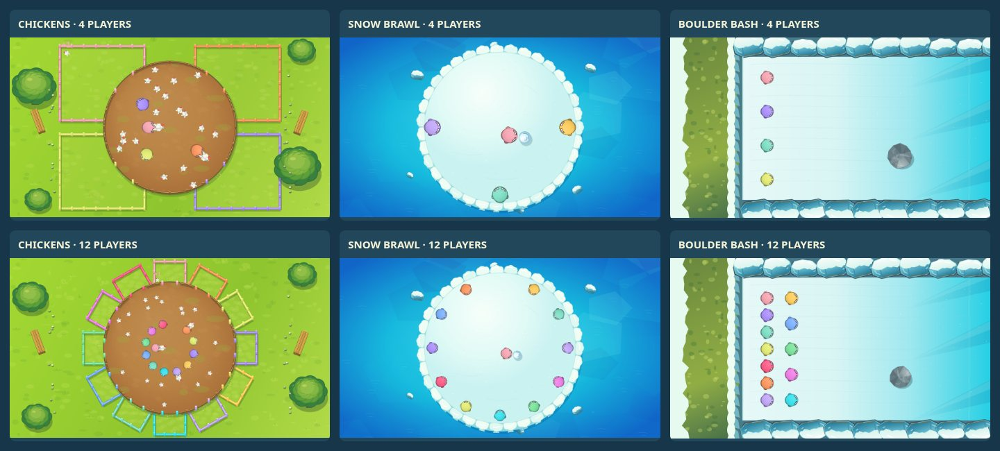
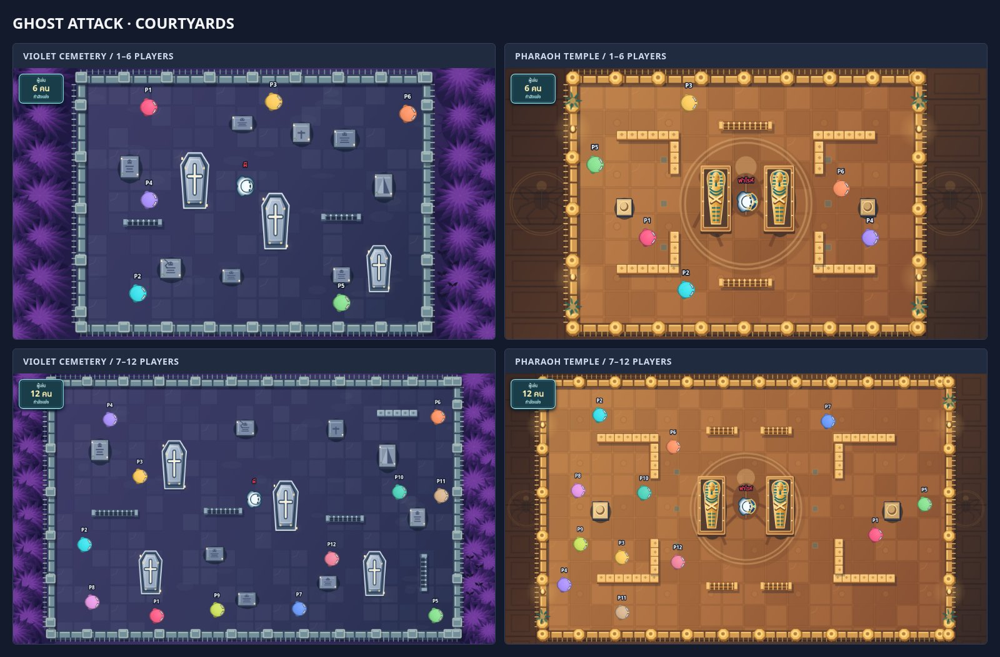

# GAME-FRIENDS — STICK SQUAD PARTY


ภาพปกเกมอยู่ใน `assets/game-friends-cover.svg` พร้อมภาพแชร์ `assets/game-friends-social.png` และไอคอน `assets/game-friends-icon.svg` ใช้จากไฟล์ใน repository โดยตรง

เกมปาร์ตี้เล่นบนเว็บแบบจอใหญ่ + จอยมือถือผ่าน QR Code สูงสุด **12 ผู้เล่น**
มีมินิเกม **GHOST ATTACK**, **CHICKENS**, **FRUIT MEMORY**, **SHOCKWAVE**, **COLOR SWITCH** และ **PIZZA TIME** ใช้ระบบห้อง จอยมือถือ พรีวิวและการแข่งขันเดียวกัน; มินิเกมเก่า STAR RUSH, BRAWL, LAVA RUN, TANKS, FOOTBALL, RALLY และ COLOR CLASH ไม่ได้ถูกนำกลับมา

## สนาม CHICKENS / SNOW BRAWL / BOULDER BASH

ปรับสนามตามภาพอ้างอิง 1961 / 1744 / 1848 โดยใช้ภาพ SVG ต้นฉบับใน `farm-ice-art.js`:

- **จับไก่:** ลานดินวงกลม สนามหญ้า ต้นไม้และม้านั่ง คอกใหญ่ตามมุมสำหรับ 1–4 คน และคอกรอบวงสำหรับ 5–12 คน รั้วเว้นช่องตามประตูที่ใช้ฝากจริง ไก่ที่อุ้มมีตัวและปีก ไก่ที่ฝากแล้วอยู่ในคอกเจ้าของจริง ทุกคอกเก็บได้ทั้งโควตาโดยไม่ใช้ตำแหน่งซ้ำ
- **ปั้นหิมะ:** เกาะหิมะสีขาวมีชั้นหน้าผาน้ำแข็งกลางทะเลฟ้า กล้องจัดขนาดให้ขอบเกาะอยู่ครบจอทุกจำนวนคน ภาพพื้นเกาะใช้รัศมีเดียวกับระบบตกน้ำและหดใน Sudden Death โดยกล้องไม่ซูมตาม ขนาดตัวละครและฟิสิกส์เดิมยังคงอยู่
- **หลบหินกลิ้ง:** หน้าผาหญ้าและหิมะทางซ้าย พื้นน้ำแข็งลาดจากทางขวา แนวผาน้ำแข็งบน–ล่างตรงกับขอบชนจริง หิน SVG มีเหลี่ยมและหมุนตามการเคลื่อนที่ ผู้เล่นเริ่มเป็นแถวแนวตั้งด้านซ้าย และเพิ่มแถวที่สองเมื่อมี 8–12 คน

ทั้งสามสนามใช้ HUD กลางกับรายชื่อผู้เล่นชุดเดิม โดยจัดพื้นที่สนามไว้ใต้ HUD เพื่อไม่ให้รายชื่อ 12 คนบังตัวละครบนจอเล็ก ฉากนิ่งแคชต่อรอบ การวาดไม่สุ่มหรือเปลี่ยนสถานะเกม ทดสอบผัง ประตูและบอทครบ 1–12 คนด้วย `node tests/farm-ice.cjs`; ทดสอบหน้า HOST, SVG, การจับ–ฝากไก่ การปล่อยหิมะ การชนหิน และจอแนวนอนด้วย `node tests/farm-ice-browser.cjs` (Playwright; CI รัน Chromium และ WebKit) เปิดดูสนามได้ที่ `tools/art-preview.html`



## SNOW BRAWL — Snowball Island Survival

เกาะหิมะกลางทะเลแบบ Top-down ผู้เล่น 1–12 คน ตัวละคร SNOW BRAWL แสดงผลใหญ่ขึ้น 20% พร้อมขยายกรอบชนให้ตรงกัน (ไม่กระทบความเร็วเดินหรือขนาดตัวละครในเกมอื่น)เดินสะสมหิมะตามระยะทางจริง ขนาดลูกหิมะ **ไม่มีผลต่ออัตราเร่งและความเร็วเดิน** กด A หยุดเตรียม 0.15 วินาทีแล้วปล่อย หิมะที่กลิ้งไม่มีแรงเสียดทานผิวและคงความเร็วตามขนาดตั้งแต่ 320 ถึง 224 หน่วย/วินาที (เร็วสุดไม่เกิน 1.5 เท่าของช้าที่สุด) การเลี้ยวเปลี่ยนทิศช้าลงและลูกหิมะที่ถือจะอยู่ตรงหน้าตัวละครเสมอ หิมะที่ปล่อยแล้วชนหิมะที่เพื่อนกำลังปั้นจะทำให้ทั้งสองลูกแตก พร้อมส่งแรงกระแทกตามมวลและความเร็วให้ผู้ถือ ลูกหิมะชนคนถ่ายโอนโมเมนตัมด้วยมวลแปรตามรัศมียกกำลังสาม ชนลูกหิมะแตกสองลูก Snow Crush ทำให้แบน 0.7 วินาที และผู้เล่นที่ถูกกระเด็นชนเพื่อนสามารถส่งแรงต่อเป็นลูกโซ่ได้ อันดับอิงเวลาตกรอบ ฟิสิกส์ fixed step 60Hz โหมดเดี่ยวครบ 60 วินาที โหมดหลายคนรอดคนสุดท้าย และ Sudden Death เกาะเริ่มหดหลัง 90 วินาที; เป็นมินิเกมแยกไม่กระทบกระดาน BOARD PARTY. ทดสอบด้วย `node tests/snow-brawl.cjs`.

## BOULDER BASH — Snow Slope Survival

มินิเกมเอาตัวรอด 1–12 คน: หินจากทางขวากลิ้งตามแรงโน้มถ่วงและเอียงเปลี่ยนทิศได้ ผู้เล่นเดินบนหิมะที่ลื่นพร้อมแรงเฉื่อย ใช้ A ผลักคู่แข่งโดยไม่สตั้น ผู้ตกรอบมีโอกาสควบคุมหินสีตัวเอง (เลี้ยวและเร่งลงเขาได้ แต่บังคับย้อนขึ้นเนินไม่ได้) อันดับยึดเวลาตกรอบ ไม่คืนชีวิตแก่เจ้าของหิน และไม่กระทบ HP/ไอเทม BOARD PARTY. โหมดเดี่ยวอยู่รอดครบ 60 วินาที ขณะที่โหมดหลายคนตัดสินจากผู้รอดชีวิตคนสุดท้าย ทดสอบด้วย `node tests/boulder-bash.cjs`.

## BOARD PARTY — Winter Snow Adventure

เพิ่มโหมดกระดานต่อเนื่องแยกจาก **NORMAL PARTY** เลือก **BOARD PARTY • กระดานหิมะ** ในล็อบบี้ได้ทันที รองรับ 1–12 คน ทอยสองลูกกลางจอ ใช้อนาล็อกเดินอิสระภายในช่องและแนวทางเดิน ถอยแก้ทางหรือเลี้ยวกลับไปเลือกกิ่งใหม่ก่อนถึงช่องถัดไปได้โดยไม่เสียก้าว มีตัวนับก้าวป้องกันข้ามช่อง พร้อม **กระเป๋าไอเทมสะสมหลายชิ้น** (B เลือกไอเทม → A ยืนยัน) รองรับไอเทม 6 ชนิดรวมโล่ และเล่นมินิเกมเดิมเมื่อครบหนึ่งรอบ ผู้เล่นครึ่งบนได้รับไอเทมเข้ากระเป๋าอัตโนมัติก่อนกลับกระดานเดิม โดยเรียงตารอบใหม่ตามอันดับมินิเกม ผู้ถึง FINISH ก่อนชนะ

แมพ **Fixed Expedition v3** มี **9 เกาะ / 152 ช่วงหลัก / 212 Node รวมทางเลือก** เส้นทางเดินทั่วเกาะใหญ่ 4 เกาะ วกกลับเข้าหมู่บ้านและทะเลสาบผ่านสะพานอีกด้านโดยใช้ Node ใหม่ พร้อมทางแยกสามทาง ทุกพิกัด ประเภทช่อง เกาะ สะพานและของตกแต่งกำหนดไว้ล่วงหน้า 100% ไม่เปลี่ยนตาม seed กล้องภาพรวมให้ลากและซูมจนกดเริ่มทอย กล้องติดตามเห็นทางเลือกที่ทางแยก พร้อม Debug เกาะ/สะพานและ Graph ข้อมูลแมตช์จาก map version เก่าต้องเริ่มใหม่ รายละเอียดและผลทดสอบอยู่ใน [คู่มือ BOARD PARTY](docs/board-party.md)

ดู [ภาพรวมแมพ](docs/board-overview.jpg) หรือ ดู [วิธีเล่น กติกาไอเทม โครงสร้าง และผลการทดสอบ](docs/board-party.md) หรือรัน `node tests/board-party.cjs` และ `node tests/smoke.cjs`

## นโยบายภาพในเกม: ใช้ SVG เท่านั้น ห้ามใช้อีโมจิ

- ห้ามใส่อีโมจิจากฟอนต์อุปกรณ์ใน HUD, แถบรายชื่อ, ออร์เดอร์, กล่องวัตถุดิบ, จอย, เอฟเฟกต์ หรือส่วนอื่นของเกม
- ใช้ไฟล์ SVG ที่สร้างเองเท่านั้น ไม่ใช้ข้อความเป็นสัญลักษณ์ภาพ รวมถึงดาวและประกาย
- `src/games/pizza-time/pizza-ingredient-art.js` เป็นชุด SVG วัตถุดิบ 10 ชนิด ใช้แหล่งเดียวกันกับสนาม PIZZA TIME, แถบคะแนนจอหลัก และจอยมือถือ ไม่มีการแปลงไอคอนเป็นอีโมจิ
- `party-ui-art.js` เป็นชุด SVG สำหรับดาว ประกาย และสถานะ ส่วนไอคอนใน HTML เช่น เต็มจอและสัญลักษณ์แบรนด์เป็น inline SVG
- กล่องออร์เดอร์ของ PIZZA TIME ใช้ `planOrderCards()` เลือกตำแหน่งจากกรอบตัวเชฟและกรอบกล่องอื่น โดยไม่วาดทับตัวเชฟหรือทับกัน แม้มีผู้เล่น 12 คน
- ทดสอบระบบภาพด้วย `node tests/pizza-time.test.cjs` และระบบรวมด้วย `node tests/smoke.cjs` พร้อมตรวจว่าสคริปต์ SVG ทั้งสองไฟล์ถูกระบุใน `scripts/build-static.cjs` ก่อน Deploy เพื่อป้องกัน asset เก่าจากแคช

## ระบบกลางตัวละครและกฎชนกัน (ใช้กับทุกแมพ)

ระบบกลางอยู่ที่ `character-system.js` โหลดหลัง `player-avatar.js` และก่อนมินิเกมทุกตัว โดย `window.PartyCharacters` เป็น API กลางสำหรับตัวละคร การเดิน ทิศทาง ความเร็ว วาดตัวละคร และการชน/ดันกันแบบ host-authoritative

**กฎบังคับสำหรับทุกเกม:** เมื่อไม่ได้ระบุไว้ว่าเดินทะลุกันได้ ตัวละครทุกตัวต้องชนและดันกันได้เป็นค่าเริ่มต้น (รวมบอทด้วย) ต้องไม่คัดลอกหรือสร้างระบบแยกในแต่ละเกม โดยเกมจะส่งเฉพาะค่าขอบสนาม รัศมีตัวละคร กำแพง/สิ่งกีดขวาง และข้อยกเว้นที่กติกากำหนดไว้ให้ระบบกลาง

ตัวอย่างการใช้งานสำหรับมินิเกมใหม่:

```js
const characters = window.PartyCharacters;
characters.activate(players); // เปิดใช้ผู้เล่น/บอทหลังสร้างห้อง
for (const p of players) {
  const direction = p.isBot ? chooseBotMovement(p) : characters.control(p.input);
  characters.move(p, direction, dt, {
    speed: 165, radius: 15, bounds: board
  });
}
characters.resolve(players, {
  radius: 15, bounds: board,
  // Optional: constrain เพื่อคงผนัง โต๊ะ สิ่งกีดขวาง หรือสนามวงกลม
});
for (const p of players) if (p.active) characters.draw(ctx, p, {time:clock});
```

- `characters.resolve(players)` ทำงานโดยตั้งต้น `playersSolid:true` อัตโนมัติ รองรับการเกิดทับตำแหน่งกัน แรงดันจากทิศทาง/ความเร็ว และผู้เล่นสูงสุด 12 คน
- การยกเว้นให้เดินทะลุผู้เล่นต้องเขียน `playersSolid:false` **ชัดเจนเฉพาะเกมที่มีข้อกำหนดนั้นจริง** ห้ามถือว่าการไม่ส่งค่าหมายถึงปิดการชน
- ระบบกลางไม่ตัดสินการติดเชื้อผี การตกพื้น ระเบิด การเก็บของ หรือคะแนน กติกาเหล่านี้ยังอยู่ในเอนจินมินิเกม และต้องตรวจ hitbox/สิ่งกีดขวางตามแผนที่เดิม
- `GHOST ATTACK`, `CHICKENS`, `FRUIT MEMORY`, `SHOCKWAVE`, `COLOR SWITCH` และ `PIZZA TIME` เรียกโมดูลชนกลางแทนการคำนวณชนแยกภายในเกม
- ทดสอบระบบกลางด้วย `node tests/character-system.cjs`; ทดสอบระบบเดิมด้วยสคริปต์ใน `tests/`

## วิธีเข้าเล่น

1. เจ้าของห้องเปิด `/host.html` เพื่อสร้างห้องและแสดง QR / รหัส 6 ตัวในหน้าล็อบบี้
2. เพื่อนสแกน QR หรือเข้าที่ `/?join=รหัสห้อง` จากโทรศัพท์ ชื่อเล่นจำไว้ในเครื่อง
3. จอยมือถือเลือกหนึ่งใน 7 มินิเกมจากตัวเลือกเกม เจ้าของห้องเห็นรายชื่อและสถานะการเลือกทั้งหมดบนจอหลัก
4. เจ้าของห้องเลือกสุ่มหนึ่งเกมหรือเล่นครบทุกตัวเลือก (แต่ละคนเลือกเกมเดียวกันซ้ำได้) แล้วกดเริ่ม
5. สนามเต็มจอพร้อมพรีวิว WebRTC บนมือถือ และกลับล็อบบี้ได้โดยรักษา Fullscreen บนเบราว์เซอร์ที่รองรับ

## กติกา CHICKENS (เกมที่ 2)

- เล่น 1–12 คนในสนามวงกลม มีคอกที่ขอบสนามตามจำนวนผู้เล่นและสีประจำตัว
- วิ่งสัมผัสไก่เพื่อจับอัตโนมัติ อุ้มได้ครั้งละหนึ่งตัว จับแล้วจะยื่นแขนถือไก่ไว้ด้านหน้า
- ฝากหัวไก่ผ่านปากคอกและจุ่มค้าง **0.15 วินาทีต่อเนื่อง** จึงได้ 1 คะแนน; ฝากคอกคนอื่นได้ แต่คะแนนเป็นของเจ้าของคอกนั้น
- **ปุ่ม A** ใช้ระบบต่อยกลาง สตั้นเพื่อนที่โดน 0.8 วินาที และทำให้ผู้ที่อุ้มไก่ปล่อยไก่ ต้องปล่อยปุ่มก่อนกดครั้งถัดไป
- ไม่มีปุ่ม B ในรอบ CHICKENS; ปุ่ม B, ระบบไอเทมและเป้าหมายของ GHOST ATTACK กลับมาเมื่อเล่นเกมผี
- **โควตาไก่ต่อรอบ = (จำนวนผู้เล่น × 5) + 1 ตัว** เช่น 2 คน = 11 ตัว, 4 คน = 21 ตัว, 8 คน = 41 ตัว, 12 คน = 61 ตัว จำนวนนี้หารด้วยจำนวนผู้เล่นไม่ลงตัว จึงช่วยลดโอกาสคะแนนเสมอ *เมื่อฝากไก่ครบทั้งรอบ* แต่ยังมีสิทธิ์เสมอได้หากคะแนนสูงสุดเท่ากันตามจริง ปล่อยในสนามพร้อมกันสูงสุด 20 ตัว (รวมตัวที่ถูกอุ้ม) และเติมจากโควตาที่เหลือเมื่อฝากไก่สำเร็จ ไม่เกิดซ้ำไม่จำกัด
- ไก่มีขนาดเล็กลง เลี้ยวหลบเร็วขึ้น วิ่งลื่นขึ้น และเร่งหนีเป็นจังหวะสั้นเมื่อผู้เล่นเข้าประชิด
- ผู้เล่น 1–4 คนแข่งสูงสุด 20 วินาที, 5–8 คน 30 วินาที และ 9–12 คน 40 วินาที **แต่หากฝากไก่ครบโควตาทั้งรอบเมื่อใด เกมจบทันทีและสรุปผู้ชนะ**; คะแนนสูงสุดชนะ หากเท่ากันเสมอ
- ความเร็วเดินของผู้เล่นและการวิ่งของไก่ (รวมการเร่งหนี การเลี้ยว และแอนิเมชันการเคลื่อนที่) ลดลง 30% โดยคงเวลาการแข่งขันและเวลาฝากไก่ 0.15 วินาทีไว้
- AI ไก่คำนึงถึงผู้เล่นและแนวรั้ว; บอทผู้เล่นสามารถจับ อุ้ม ฝากและแย่งไก่ตามกติกาเดียวกับคน
- ทดสอบออฟไลน์ได้โดยเพิ่มบอท แล้วคลิกเกมบนการ์ดบอทเพื่อสลับจาก GHOST ATTACK เป็น CHICKENS

## HUD ของจอหลัก

- เหลือเพียงชื่อ **GHOST ATTACK** ทางมุมบนซ้าย ไม่มีคำอธิบายย่อยใต้ชื่อ
- จำนวนมนุษย์ที่ยังรอด (เช่น **2 คน**) แสดงในกรอบเล็กด้านบนตรงกลาง พร้อมแถบรายชื่อผู้เล่นที่ยกขึ้นมาให้อยู่ภายในพื้นที่ส่วนหัว
- รายชื่อผู้เล่นแสดงในแถวเดียวเสมอ แม้ครบ 12 คน โดยลดขนาดแต่ละช่องและย่อชื่อยาวแทนการตัดเข้าแผนที่
- ไม่วาดข้อความนับจำนวนคน/ผีหรือคำบรรยายแผนที่ภายใน Canvas อีก การนับถอยหลังยังแสดงผ่านข้อความกลางจอตามเดิม

## กติกา GHOST ATTACK

- เริ่มสนามแล้วผู้เล่น **เกิดกระจายแบบสุ่มและเดินได้ทันที**
- นับถอยหลัง **3 วินาที** ก่อนที่ผี AI สีขาวจะปรากฏตรงกลางสนามและไล่มนุษย์
- อัตราเริ่มต้น: **1 ผี AI ต่อผู้เล่นสูงสุด 4 คน** (1–4 คน = 1 ผี, 5–8 คน = 2, 9–12 คน = 3)
- ผู้เล่นที่ถูกผีแตะ **กลายเป็นผีและยังใช้จอยบังคับไล่จับมนุษย์ได้** ผีผู้เล่นใช้สีประจำตัว ส่วนผี AI เป็นสีขาว
- คนเดินทะลุสิ่งกีดขวางไม่ได้ แต่ผีทุกชนิดทะลุได้
- ผีวิ่งเร็วกว่าคนเพียง ~2.3% (คน 172 / ผี 176 หน่วยต่อวินาที จากเดิมผี 184) และมีมุมการหันที่ช้ากว่าคนเพียงเล็กน้อย
- ผี AI มักเลือกคนใกล้ที่สุด **ล็อกเป้า 1.2–1.85 วินาที** ไม่ส่ายเป้าไปมา; จะเปลี่ยนก่อนกำหนดถ้าคนใหม่เข้าใกล้กว่าชัดเจน และบางครั้งเลือกผู้เล่นอีกคนที่อยู่ใกล้พอ ๆ กัน
- แผนที่ขยายตามจำนวนคน โดยทุกขนาดเริ่มจากพื้นที่สำหรับอย่างน้อย 4 คน: 960×540, 1200×675 และ 1440×810 world units
- **ไม่มีตัวจับเวลา**: จบเมื่อเหลือมนุษย์คนเดียว ซึ่งเป็นผู้ชนะ; หากหลายคนถูกจับพร้อมกัน ระบบเลือกมนุษย์ที่โดนจับเป็นคนสุดท้าย
- เจ้าของห้องสามารถพักเกม เล่นต่อ หรือออกกลับล็อบบี้ได้

## การบังคับและไอเทม

- อนาล็อกซ้าย: กดตรงไหนก็ได้แล้วลากเพื่อเดินทุกทิศทาง
- **A:** ตีเพื่อนในระยะใกล้ ทำให้สตั้นช่วงสั้น ~0.63 วินาที พร้อมคูลดาวน์
- **B:** ใช้ไอเทมที่เก็บได้; เก็บได้ครั้งละ **1 ชิ้น** ต้องใช้ก่อนเก็บใหม่
- กล่องสุ่มจำนวนจำกัดปรากฏตามตำแหน่งแบบสุ่มหลังเริ่มเกม และค่อย ๆ เกิดใหม่ ไม่ล็อกตำแหน่งเดิม
- **เก็บกล่องแล้วขึ้นข้อความเหนือหัวผู้เก็บทันที** ว่า `ได้รับ: ชื่อไอเทม` สีเหลืองอ่านง่าย อยู่ชั่วคราวประมาณ 2.1 วินาทีแล้วหายเอง และถูกล้างเมื่อเปลี่ยนเป็นผีหรือเริ่มรอบใหม่
- **แถบรายชื่อด้านบนของจอหลัก** แสดงชื่อไอเทมที่ถืออยู่ต่อท้ายชื่อผู้เล่นทุกคนแบบเรียลไทม์ ใช้ชื่อเต็มเมื่อมีไม่เกิน 4 คน และชื่อย่อที่อ่านออกเมื่อมี 5–12 คน พร้อมชื่อเต็มใน tooltip; หลังใช้ไอเทมหรือกลายเป็นผีจะหายจากแถบเอง
- **ผ้าคลุมล่องหน:** ซ่อนจากการล็อกเป้าของผี AI 2 วินาที (หากบังเอิญชนผีโดยตรงยังโดนจับได้)
- **บูสต์สปีด:** เพิ่มความเร็วชั่วคราว 2.6 วินาที
- **สตั้นผี:** หยุดผีรอบตัวในระยะสั้น 1.45 วินาที
- **กับดัก:** วางไว้บนพื้น คนที่เหยียบจะถูกล็อกเดินชั่วคราว ผีไม่ติดกับดัก; กับดักหน่วงการทำงานสั้น ๆ เพื่อไม่งับผู้วางทันที
- **ยาสโลว์เพื่อน:** กด B ครั้งแรกเพื่อเข้าหน้าเลือกเป้าหมาย, จะปรากฏปุ่ม **▲ / ▼ ข้างปุ่ม B** ให้สลับชื่อเพื่อน และจอหลักแสดงวงสีของผู้ใช้สกิลรอบตัวเพื่อนเป้าหมาย กด B อีกครั้งเพื่อสโลว์เป้าหมาย 2.5 วินาที
- **ข้อมูลในจอยแสดงเฉพาะระหว่างเล่นเกมจริง:** สถานะมนุษย์/ผีและไอเทมอยู่ที่ **แถบด้านบนของจอย** และแสดงเฉพาะ GHOST ATTACK เมื่อเข้ารอบแล้ว (เริ่มนับถอยหลัง / เล่น / หยุดชั่วคราว) ไม่แสดงระหว่างอยู่ล็อบบี้ หน้าเข้าร่วม หลังจบรอบ หรือในมินิเกมชนิดอื่นที่จะเพิ่มในอนาคต; แพ็กเก็ตไอเทมจากเกมอื่นหรือรอบที่จบแล้วจะถูกละเลย
- **ปุ่ม A/B:** คำว่า **ตีสตั้น** และ **ใช้ไอเทม** แสดงใต้ตัว A/B **ภายในวงกลมปุ่ม** ไม่ใช่ด้านข้าง และเมื่อกำลังเลือกยาสโลว์ ปุ่ม B เปลี่ยนคำเป็น **ยืนยันสโลว์**
- **จอพรีวิว:** ขยับกรอบทั้งแผงไปทางปุ่ม A/B ด้วย CSS `translateX` โดย **ไม่เปลี่ยนความกว้าง ความสูง หรือสัดส่วนภาพ** และลดระยะขยับบนจอเล็ก
- จอยแสดงชื่อไอเทมที่ถืออยู่ สถานะมนุษย์/ผี และชื่อเพื่อนเป้าหมายที่เลือกไว้ (ในช่วงเกมเท่านั้น)
- คีย์บอร์ดทดลองเล่น: P1 ใช้ WASD, Space = A, Shift = B และ Q/E เลือกเป้า; P2 ใช้ปุ่มลูกศร, Enter = A, Shift ขวา = B และ Numpad8/Numpad2 เลือกเป้า

## สถาปัตยกรรม

- `src/games/ghost-attack/ghost-attack.js`: สถานะสนาม, การเคลื่อนที่, AI ล็อกเป้า, การติดเชื้อ, การชน, ไอเทม, การเลือกเป้า และ Canvas renderer (เกมใหม่แยกจากระบบห้อง)
- `src/games/chickens/chickens.js`: Engine เกมไก่ การชน การเลือกทางหนี การอุ้ม คอก คะแนนและการเรนเดอร์ Canvas
- `app.js`: PeerJS, ห้อง QR, จอยมือถือ, เลือก Engine ตามโหมด, การรับ input ที่เครื่องเจ้าของห้องตรวจสอบ, การควบคุมรอบ, Fullscreen และพรีวิวเกมแบบ WebRTC
- `index.html`, `style.css`: หน้าจอเจ้าของห้อง, จอย, แถบไอเทม และปุ่มเลือกเป้า
- `host.html`: ทางเข้าหน้าเจ้าของห้อง; ส่วน URL ปกติเป็นหน้าจอยเข้าร่วมห้อง
- `tests/smoke.cjs`, `tests/chickens.cjs`: ทดสอบ GHOST ATTACK, CHICKENS, ระบบสลับเกม การเชื่อมจอยและการฝากไก่
- `.github/workflows/verify.yml`: ตรวจ Node syntax, หน้าเว็บและชุด smoke test

เว็บนี้เป็น static hosting ผ่าน AWS Amplify; อุปกรณ์ที่เข้าจอยจำเป็นต้องเชื่อม PeerJS และบางเครือข่ายอาจต้องมี TURN server การแยกหน้าโฮสต์กับจอยเป็นเพียงการนำทาง UI **ไม่ใช่ระบบยืนยันสิทธิ์เจ้าของห้องที่ปลอดภัย** การคุมสิทธิ์จริงต้องมี backend

วิดีโอจอยเลือกระดับ 144p / 540p / 720p / Auto โดยไม่ล็อก FPS ตามคุณภาพ (เบราว์เซอร์/เครือข่ายอาจปรับ FPS เอง) โหมดเต็มจอยังขึ้นกับข้อจำกัด iOS/Safari


## Native-resolution host canvas

- The main game canvas still uses a **960×540 logical coordinate system** for every minigame, but its physical backing bitmap now follows the rendered display size and device pixel ratio (up to 3×, i.e. 2880×1620). This removes low-resolution upscaling on iPad/Retina screens without altering movement, collision, tile counts, UI geometry or game timings.
- The host bitmap is rebuilt only when the host view, window/orientation or device pixel ratio changes. Remote phone-preview video retains its independently selected stream resolution; a clearer host display does not force high-bandwidth phone streams.

## Room continuity and web patching

- A host lobby refresh reopens its original PeerJS room ID from tab-scoped session storage, preserving player seats, local bots, selected games and settings. Joined controllers store a stable per-tab token and automatically reconnect to the saved room after an update or refresh.
- Unexpected disconnects hold a remote player's slot for up to 60 seconds. Explicit departure removes the slot immediately.
- The auto-update checker runs periodically and on visibility/focus, and may refresh idle host lobbies, controller join forms, joined controllers in the lobby, offline lobbies and home, restoring each page after the new version loads. It defers updates during active matches.
- **Limit:** A manual browser reload of the host in the middle of a match returns to the same room lobby but cannot resume the in-memory live game; uninterrupted match state would need server-side persistence. Reconnecting to a PeerJS room still requires network access.

## FRUIT MEMORY (third mini-game)

- 1–6 players: **4×4** grid, **80 world units per tile**, 320×320 board centered at (320, 110); 4 selected fruit types and a 5-second move phase.
- 7–12 players: **5×5** grid, **80 world units per tile**, 400×400 board centered at (280, 70); 5 selected fruit types and a 7-second move phase.
- Player collision radius stays 13 world units in both tiers. Foot support, movement bounds, first-round spawn, and bot targets derive from these actual tile rectangles.
- On the shared 3-second start countdown, both orange monitors are present and blank while players and bots may move. Only after countdown does the independently timed memorize/reveal phase begin. Fruit images reveal in four randomized batches with full tile coverage.
- Each elimination uses fixed-step snapshots and safe tile foot-contact area; simultaneous elimination can cause a replay. Survivors and tile geometry remain in place between memorization rounds.
- See [MAP-001–007 map scale rules](docs/MAP_SCALE_RULES.md) and [per-game audit](docs/MAP_SCALE_AUDIT.md). Run `node tests/fruit-memory.cjs`, `node tests/map-scale-regression.cjs` and `node tests/smoke.cjs`.

## ภาพตัวละครและธีมมุมบน (Overhead art)


- ทุกมินิเกมใช้ `player-avatar.js`: ตัวป้อมฮู้ดนักสำรวจ ไก่ ฟาโรห์ และจิ้งจอก ขนาดมาตรฐาน 52×52 หมุนตามจอย มีท่ายืน เดินสลับเท้า อุ้ม และตี โดยชื่อยังอ่านในแนวนอน
- ชุดประจำตัวผูกกับ ID ผู้เล่น จึงคงเดิมเมื่อสลับเกม สีประจำตัวไม่หาย และไม่มีผลต่อ hitbox, ความเร็ว หรือกติกา
- `arena-art.js` วาดพื้นตกแต่งแบบคงที่และแคชต่อรอบ รองรับความละเอียดสูงถึง 2× โดยไม่สุ่มหรือแก้สถานะเกมระหว่างวาด
- CHICKENS: ลานดินกลางสนามหญ้า รั้วเว้นช่องตามประตูคอกจริง และคอกสีผู้เล่น
- SHOCKWAVE: แท่นหิน 5×5 กลางลาวา ช่องอันตรายมีสีส้มกะพริบ ขอบสว่าง และเครื่องหมาย `!`; พื้นยังคงอยู่ตามกติกาเดิม
- FRUIT MEMORY: สวนผลไม้ การ์ดม่วงด้านหลังเหมือนกันทุกชนิด สีและรูปผลไม้ปรากฏเฉพาะตอนเปิดเท่านั้น
- GHOST ATTACK: ผังลานสุสานและวิหารอียิปต์ v4 ออกแบบไว้ล่วงหน้า 4 แบบ แบ่ง 1–6 คน (1080×608) และ 7–12 คน (1280×720) สุสานมีป่าสนม่วง รั้วเหล็ก ป้ายหลุมศพและโลงยาว ส่วนวิหารมีโลงฟาโรห์คู่ ลายแมลงปีกแข็ง เสาและกำแพงตัว L ทุกชิ้นใช้ตำแหน่งเดียวกันในภาพ ระบบชน และเส้นทางบอท สนามใหญ่มีพื้นที่เดินจริงเพิ่มมากกว่า 50% และจัดทางหลบเพิ่ม
- รั้วรอบนอกกั้นทั้งคนและผี ส่วนสิ่งกีดขวางด้านในยังให้ผีทะลุได้ตามกติกาเดิม จุดเกิดและกล่องไอเทมเลือกเฉพาะพื้นเดินได้ การใช้บูสต์หรือเฟรมหน่วงไม่ทำให้เดินทะลุรั้วบาง ปุ่มตรวจสอบแผนที่ยังแสดง ID และกรอบชนจริง
- ทดสอบผัง การชน ทางเดิน และบอทครบ 1–12 คนด้วย `node tests/ghost-courtyards.cjs`; ทดสอบภาพและจอ HOST ใน Chromium/WebKit ด้วย `node tests/ghost-courtyards-browser.cjs` (ต้องมี Playwright)



เปิดพรีวิวตัวละครและทั้ง 5 ธีมโดยไม่ต้องสร้างห้อง:

```sh
python3 -m http.server 8080
# เปิด http://localhost:8080/tools/art-preview.html
```

หน้า preview ใช้ตัววาดและสถานะจาก engine จริง เลือก 4/8/12 ผู้เล่นและดูท่าเดินได้ แต่หยุดกติกาเกมไว้เพื่อเทียบภาพ (ไม่ใช่โหมดเล่นจริง)


## มินิเกมที่ 6 — PIZZA TIME

การแข่งขัน 60 วินาที ผู้เล่น 1–12 คนรับออร์เดอร์ส่วนตัว 2 ชนิด **ถือได้แค่ครั้งละ 1 ชิ้น** ต้องเดินหยิบวัตถุดิบจากโต๊ะกลางแล้วกลับมาส่ง **เชฟประจำตัวเอง** ทีละชิ้น รวมสองเที่ยวจึงได้ 1 คะแนน มีออร์เดอร์ใหม่ทันที เมื่อหมดเวลาออร์เดอร์ที่ไม่ครบ 2 ชนิดไม่คิดคะแนน

- **ครัวกลางสวน:** พื้นกระเบื้องสลับสีอุ่น ต้นไม้และก้อนหินรอบสนาม เชฟสวมหมวกขาว ซุ้มลายทางสีเจ้าของ เคาน์เตอร์ไม้มีถาดสองใบ และเตาอบเรืองแสง ใช้ SVG ต้นฉบับใน `src/games/pizza-time/pizza-kitchen-art.js` ร่วมกับฉาก Canvas ที่แคชไว้
- **เชฟส่วนตัว:** ผู้เล่น 1–4 คนใช้ซุ้มมุมสนามตามภาพอ้างอิง มากกว่า 4 คนจัดเป็นสองแถวบน–ล่าง คนละซุ้ม ป้ายออร์เดอร์อยู่ข้างเชฟภายในซุ้ม ผู้เล่นเกิดฝั่งหน้าเคาน์เตอร์ของตนเอง และส่งให้เชฟคนอื่นไม่ได้
- **สเกลและทางเดิน:** ขนาดตัวละครบนจอคงที่ทุกจำนวนผู้เล่น ครัว 4 คนกว้าง 536 จากพื้นที่ออกแบบ 960 หน่วย และขยายความกว้างเป็น 704/836/868 หน่วยสำหรับ 5–6/7–9/10–12 คน โต๊ะ เตา และซุ้มเชฟเป็นสิ่งกีดขวางจริง ทางเดินครัวใหญ่เว้นระยะให้สวนกันได้
- **โต๊ะและการสุ่ม:** 1–4 คนมีโต๊ะกลาง 2 ตัว; 5–6 คน 3 ตัว; 7–9 คน 4 ตัว; 10–12 คน 5 ตัว ทุกโต๊ะมีสองช่อง **วัตถุดิบไม่ซ้ำกันทั้งสนาม** สุ่มจาก 10 ชนิด ออร์เดอร์ใช้เฉพาะของที่มีบนโต๊ะ ตำแหน่งเฟอร์นิเจอร์และจุดส่งคงที่ตามจำนวนผู้เล่น
- **ถือและวางของจริง:** จานอยู่ด้านหน้าตัวละครและหมุนตามทิศที่หัน ของที่ถือแสดงบนจาน เมื่อส่งแล้วอาหารอยู่บนถาดของเชฟจนส่งครบสองชนิด จากนั้นแสดงพิซซ่าที่ทำเสร็จช่วงสั้น ๆ โดยเริ่มออร์เดอร์ใหม่ทันที ไม่ให้คะแนนซ้ำจากแอนิเมชัน
- **สลับของทันที:** ถ้าถือมะเขือเทศแล้วไปรับชีสที่อยู่ในออร์เดอร์และยังไม่ส่ง มะเขือเทศจะถูกแทนที่ด้วยชีส ไม่สะสมจำนวน และยังไม่ได้คะแนน
- **ระยะเดิน:** แจกออร์เดอร์โดยใช้ A* คำนวณเส้นทางจากตำแหน่งเกิด/ตำแหน่งปัจจุบัน → โต๊ะกลาง → **เชฟของตัวเอง** → โต๊ะกลางอีกชนิด → เชฟของตัวเอง เปรียบเทียบความยากกับออร์เดอร์สี่ชุดของผู้เล่นคนนั้น ไม่ชดเชยตามคะแนนหรือตำแหน่งคนอื่น
- **บอทและระบบออนไลน์:** บอทเดินช้ากว่าผู้เล่นตามกติกาเดิม ใช้ A* เลี่ยงเฟอร์นิเจอร์และเพิ่มต้นทุนทางที่มีคนเบียด จอยมือถือแสดงออร์เดอร์สองชนิดและสถานะส่งจริง ปุ่ม A/B ไม่ใช้ระหว่างเล่นแต่ใช้โหวตหลังจบเหมือนเกมอื่น
- **ป้องกันภาพไม่แสดง:** สคริปต์พิซซ่าทั้งสามไฟล์อยู่ในรายการ Versioned Assets ของ `scripts/build-static.cjs` ฉากสร้างแคชใหม่เมื่อ SVG โหลดเสร็จ และหากเอนจินหรือการเรนเดอร์ผิดพลาด ระบบจะแจ้งข้อผิดพลาดและกลับล็อบบี้แทนจอดำ

ทดสอบกติกาและออร์เดอร์ด้วย `node tests/pizza-time.test.cjs` (เพิ่ม seed ด้วย `PIZZA_FAIR_SEEDS=1000`) และผังครัว การชน การถือ/วางอาหาร กับบอท 18 รอบเต็มด้วย `node tests/pizza-kitchen.cjs` ตรวจหน้า HOST จริงด้วย `node tests/pizza-kitchen-browser.cjs` หรือ `BOARD_BROWSER=webkit node tests/pizza-kitchen-browser.cjs` ภาพทดสอบอยู่ใน `/tmp/game-friends-board/pizza-kitchen` และ artifact ของ GitHub Actions การทดสอบเบราว์เซอร์นี้ไม่ใช่ผลทดสอบบนโทรศัพท์จริง


## WITCHING SNAKE — Magic broom survival

- Available in NORMAL PARTY and BOARD PARTY, for **1–12 players**. Each witch flies forward automatically. Only the joystick changes the desired heading; turning uses angular acceleration and gentle lateral inertia. A/B have no attack, boost or braking effect.
- **Host world sizes:** 960×540 (1–6 players) and 1280×720 (7–12 players). The compact, 12-facet courtyard spans **584 / 960 world units** in small rooms and **980 / 1280** in large rooms, leaving room for the corner shrines and golden groves. Its vertical radii are 222 / 300. Both use the same collision polygon as the visible neon rail. Rendering scales to the 960×540 host canvas without modifying physics.
- **Arena art:** screenshot-inspired deep-blue stone floor, understated slate mosaics, segmented magenta/gold glowing perimeter, steel corner joints, four colored shingled shrines, and golden straw fans outside the playable rail. Detailed scenery is drawn once into a cached vector Canvas; moving witches, stars, and trails remain live.
- A continuously sampled, dangerous **magic trail** follows each broom. Contact with your own older trail, any other active trail, or the arena boundary eliminates you. Dead trails fade and cease collision.
- Trails start at **190 / 230** world units; a magic star adds **48 / 65**, up to **520 / 760** respectively. Star pickups are automatic and are not points.
- Simulation uses **60 Hz fixed steps**, swept hit detection, bounded trail storage, spatial indexing, same-frame tie handling, shared player-body pushing, and deterministic tick-based elimination ranks.
- Bots evaluate prospective curved flight trajectories, boundaries, trails and reachable stars using the same turning physics as human players. On-host bot possession can override an individual bot using the existing test joystick.
- Single player survives for 60 seconds. Multiplayer ends with the last survivor, including genuine simultaneous ties. Overtime begins at 120 seconds with a visible shrinking safe boundary.
- Results record rank, elimination/survival duration and collected stars. BOARD PARTY uses the normal \`BoardMinigame\` adapter.

Development checks: \`node --check src/games/witching-snake/witching-snake.js\`, \`node tests/witching-snake.test.cjs\`, and the existing \`Verify static game\` GitHub Actions workflow.


## Market, jousting fair and broom courtyard artwork

- `party-arena-scenes.js` supplies original SVG carts, nine recognizable groceries, a skull bomb, cashiers, registers, horses, brooms, trees and colored roofs. Static scenery is cached per round and render density, invalidated once the SVGs finish decoding, and capped at 3 million pixels. Drawing never consumes gameplay RNG.
- **SHOPPING TIME:** four alternating dark conveyor lanes, peach/blue checker floors, two staffed counters and matching payment mats. The walkable market widths are 488 / 696 / 744 design units for 1–6 / 7–9 / 10–12 players. Characters, carts, goods, movement and conveyor speeds keep a consistent screen scale on both world sizes. The raised counters are outside the walking bounds; the payment mats remain inside. Carts show the actual basket products and all five occupancy marks. Capacity, 60-second duration, checkout scoring, bomb penalty and physical pushing remain unchanged.
- **KNIGHT MATCH:** a circular dirt fair with timber rails following the collision circle, four striped canopies, hay, target, crate and brazier. Larger canonical riders sit on visible brown horses. Movement speed, balloon counts/sizes, owner scoring, rainbow odds and lance reach remain unchanged. The rendered lance uses the extension from the actual collision step, so the silver tip and swept hit test coincide even after the attack timer advances.
- **WITCHING SNAKE:** a slate courtyard, glowing segmented rail, four shingle shrines and golden frond trees, with canonical overhead avatars visibly riding brooms. The courtyard is more compact for 1–6 players and wider for 7–12; the drawn rail and fatal boundary use the same polygon. Seeded spawns, steering, trail collisions, star growth and overtime retain their existing rules.
- **All 12 covers:** `game-cover-art.js` provides original text-free SVG illustrations for the phone picker, host roster, roulette and bulk bot picker, including LAWN MOWER. Each instance gets distinct gradient and clip IDs. Game names remain accessible DOM text outside the pictures. The homepage SVG also includes all twelve worlds.
- Review all scenes at `tools/art-preview.html`; choose 4 or 12 players to compare their proportions. The three new games, all twelve cover illustrations and the shared assets are versioned in the deployment build.

Checks: `node tests/party-arenas.cjs`, `node tests/shopping-time.cjs`, `node tests/knight-match.cjs`, `node tests/witching-snake.test.cjs`, `node tests/svg-only-policy.cjs`, and `node tests/party-arenas-browser.cjs`. The browser checks run against the real HOST in Chromium and WebKit, rasterize every cover, verify the three game interactions, exercise 1/4/6/9/12-player scenes and save images in `/tmp/game-friends-board/party-arenas`. GitHub Actions uploads these with the existing board, ghost and pizza screenshots.
