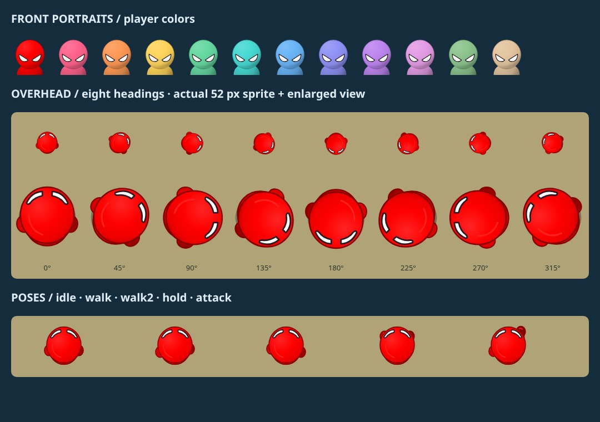

# Shared avatar camera projections

The overhead gameplay sprite follows the supplied November 6 references: a dominant round head, two compact rear-side arms, and white eye slivers on the forward rim. It has no standing torso or legs. The separately authored front portrait retains the full angular eyes and shoulders for HUD, order and results cards.

- Player colors, the 52 px sprite box, physics origin, collision radii and movement rules are unchanged.
- All shared-avatar games use the overhead projection. KNIGHT MATCH retains its separate mounted rider artwork.
- BOARD actors retain their last facing after stopping; the renderer stores this without mutating game state.
- SVG gradient IDs are scoped by color and projection to keep inline portraits independent.
- SVG and loading/error Canvas fallback use identical geometry and color data, including hold/attack poses.



[BOARD gameplay](avatar-board.jpg) · [COLOR SWITCH gameplay](avatar-color-switch.jpg)

Validation:

```sh
node tests/avatar-topdown.cjs
node tests/board-art.cjs
node tests/character-system.cjs
node tests/smoke.cjs
# Optional Playwright + Chromium raster checks
CHROME_PATH=/usr/bin/chromium node tests/avatar-browser.cjs
```

The browser test checks white eye pixels remain on the forward rim at eight headings, distinct SVG gradient identifiers for twelve colors, and raster agreement between SVG and no-Image fallback. Actual game screenshots use the real BOARD and COLOR SWITCH renderers with twelve players; they are not a physical-device performance measurement.
