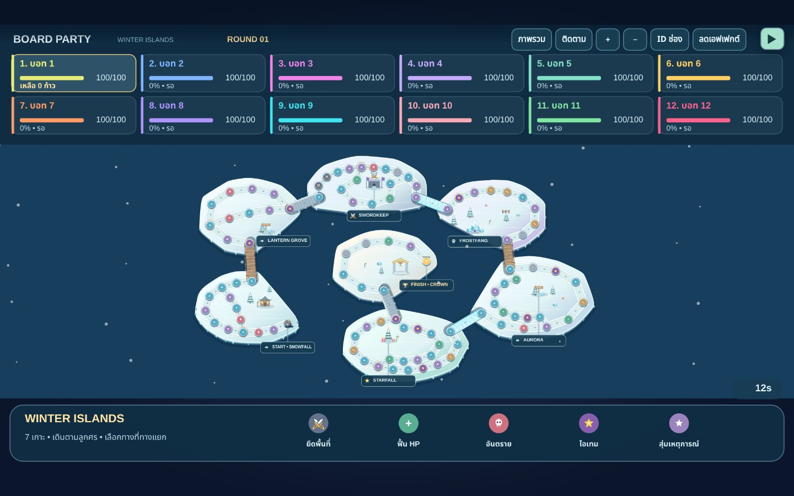
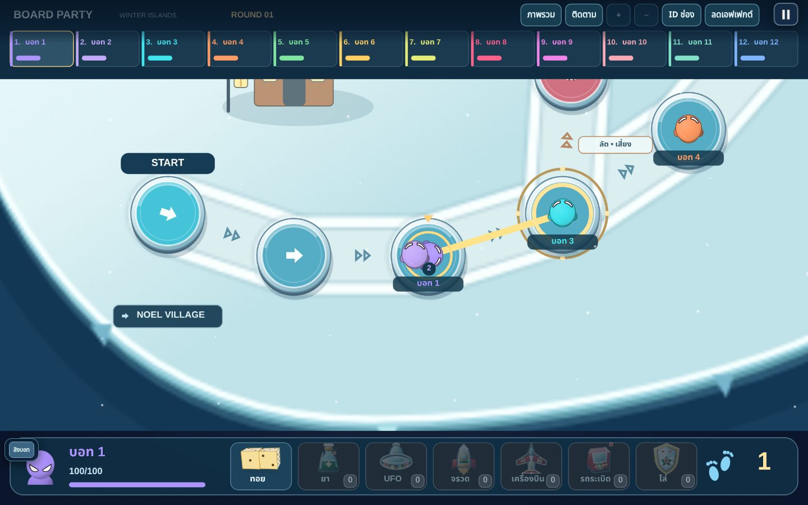
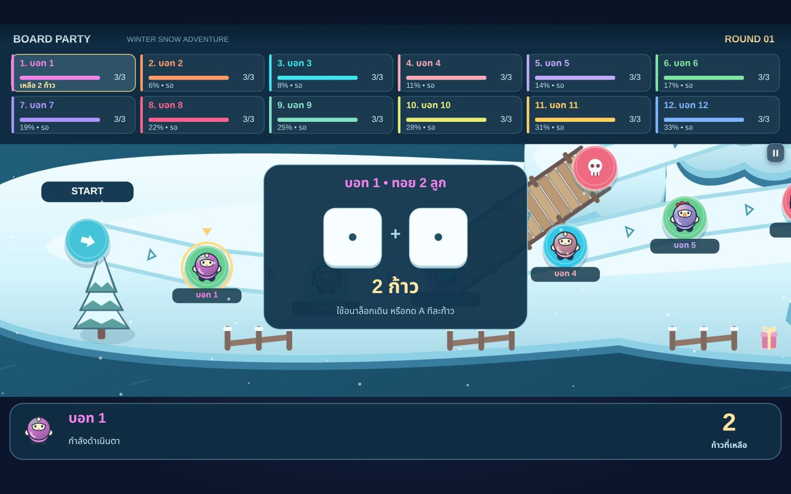
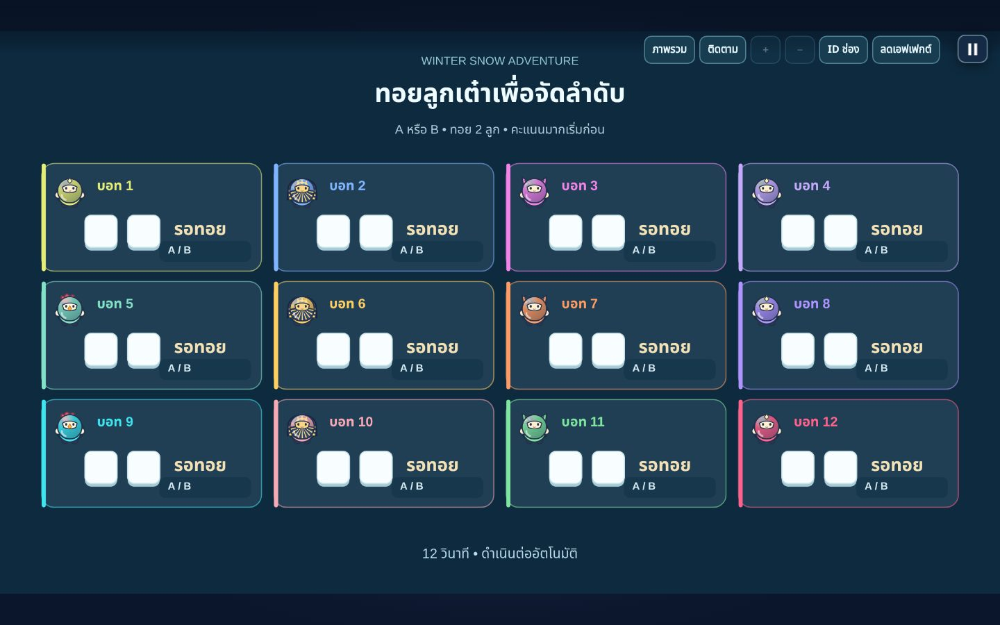

# BOARD PARTY — Winter Snow Adventure

เลือก **BOARD PARTY • กระดานหิมะ** ในล็อบบี้แล้วเริ่มได้ทันที ไม่ต้องเสนอชื่อมินิเกม รองรับ 1–12 คน (จอยมือถือและบอท) ใช้ห้อง QR และพรีวิวจอเดิม ผู้ที่ถึง FINISH ก่อนชนะ; มินิเกมเป็นกิจกรรมระหว่างรอบ ไม่ใช่ตัวจบการแข่งขัน





## แผนที่ Fixed Expedition — 9 เกาะ

`winter-expedition` มีเส้นหลัก **152 ช่วง / 153 Node** จาก START ถึง FINISH และ **212 Node** เมื่อรวมทางแยก เส้นทางสั้นที่สุด 140 ช่วง ยาวที่สุด 174 ช่วง จึงไม่มีทางลัดข้ามเกือบทั้งด่าน ความยาวนี้มากกว่า 120 จุดหลักตามโจทย์ฉบับเพิ่มเติม

| เกาะ | ช่องบนเกาะ | ภูมิประเทศและฉาก |
| --- | ---: | --- |
| Noel Village | 36 | หมู่บ้านคริสต์มาส บ้านหิมะ ของขวัญ รั้ว โคมไฟ และดาบคู่ |
| Lantern Forest | 35 | ป่าสน อ่าวทางตะวันตก ทางรูป S และทางอ้อมด้านใน |
| Frostfang Massif | 31 | ภูเขาหิมะ ถ้ำน้ำแข็ง และทางเกือกม้า |
| Mirrorfrost Lake | 45 | ทะเลสาบน้ำแข็ง ทางแยกสามทิศ และเส้นทางรอบทะเลสาบ |
| Crown Snow Castle | 16 | ปราสาทหิมะ ช่องทางคดเคี้ยวและ FINISH |
| Bell Hamlet / Aurora Outpost | 8 / 8 | เกาะขนาดกลางสำหรับทางเสี่ยงและทางอ้อมรับรางวัล |
| Comet Key / Starlight Key | 3 / 3 | เกาะเล็ก มีสะพานเข้าและออกแยกกัน |

เส้นหลักเดิน **หมู่บ้าน → ป่าสน → กลับหมู่บ้านด้านตะวันออก → ทะเลสาบ → ภูเขา → กลับทะเลสาบด้านตะวันออก → ปราสาท** การกลับเกาะเดิมใช้ Node ใหม่เสมอ มี 9 เส้นทางรองที่ออกจาก 8 จุดตัดสินใจ รวมทางแยกสามทางที่ `n76` ทุกเส้นทางเดินหน้าและบรรจบกันได้ ไม่มีทางตันหรือวงวนใน Graph และไม่มีเส้นตัดกันที่ชวนให้เข้าใจผิดว่าเชื่อมต่อกัน

พิกัด ประเภทช่อง Effects รูปทรงเกาะ เส้นเชื่อม และของตกแต่งทั้งหมดเป็น literal ใน `FIXED_MAP` ภายใน `src/board-party/runtime/board-map.js` ไม่มีการสร้างรูปร่างหรือเลือกตำแหน่งด้วย seed แม้ของตกแต่งและลายทะเลก็ไม่อ้างอิง Gameplay RNG ข้อมูล `previousNodes` และระยะทางถึง FINISH ถูกตรวจสอบกับ Graph จริง

สะพาน 14 เส้นทางใช้ไม้ เชือก น้ำแข็ง หิน และสะพานโค้ง แต่ละเส้นมีจุดเดินบนสะพานจริง (`bridgeId`, `islandId: null`) การผ่านหนึ่ง Edge ใช้หนึ่งก้าว ทางลัดมีช่องอันตราย ส่วนทางอ้อมมีช่องฟื้น HP/Lucky Star ที่กำหนดไว้ล่วงหน้า

ก่อนเริ่ม ผู้เล่นลากและซูมสำรวจได้จนกด **เริ่มทอยลำดับ** บน Host หรือ **A** บนจอย แล้วกล้องเคลื่อนไป START ใน 1.5 วินาที ห้องที่มีแต่บอทเริ่มเองหลัง 2 วินาที ระหว่างเล่นกล้องติดตามที่ขนาดอ่านตัวละครได้ และจัดกรอบให้เห็นทุกทางเลือกเมื่อถึงทางแยก ปุ่ม **ภาพรวม** หยุดเกมให้สำรวจ และ **ติดตาม** กลับมาเล่นต่อ

ปุ่ม **ID ช่อง** เปิดป้ายและแตะดู ID, X/Y, ประเภท, เกาะ/สะพาน, Previous/Next, Progress และเจ้าของพื้นที่ ช่องบนสะพานแสดง Bridge ID แทนชื่อเกาะ ปิด Debug แล้วข้อมูลพัฒนาไม่แสดง

พื้นหลังใช้ cache ไม่เกิน **3.5 ล้านพิกเซล** และปล่อยภาพเก่าเมื่อเริ่มแมตช์ใหม่ ของตกแต่งวาดเวกเตอร์ตามตำแหน่งที่กำหนดและตัดส่วนที่อยู่นอกกล้อง จึงยังคมเมื่อซูมเข้า หากสร้าง cache ไม่สำเร็จยังวาดเกาะ สะพาน และของตกแต่งที่มองเห็นได้ ปุ่ม **ลดเอฟเฟกต์** ลดหิมะ แสง และการเต้นของช่อง โดยคงกติกาเดิม

### Map Version และสถานะเก่า

ID จาก `older-map` และแผนที่เก่าที่เลิกใช้ **ไม่ใช่ตำแหน่งเดียวกับ v3** ห้ามย้ายสถานะเก่าด้วยเลข Node อย่างเดียว โค้ดตรวจ map ID ก่อน update/input/startTurn/snapshot และเมื่อกลับจากมินิเกม หากไม่ตรงให้เริ่มแมตช์ใหม่ แพ็กเก็ต Host/จอยและ snapshot มี `mapVersion` กำกับ

Reconnect ใช้ session เดิมบน Host รวมตำแหน่งโลกและเส้นทางที่กำลังเดิน ไม่ได้สร้างแผนที่ใหม่เมื่อมือถือกลับมา ระบบเดิมไม่ได้บันทึกแมตช์เต็มเพื่อโหลดต่อหลังรีเฟรช Host; การรีเฟรชและเริ่มใหม่จะได้ผัง v3 เดิมทุกครั้ง ไม่มีการแปลงตำแหน่งเก่าเงียบ ๆ

## วิธีเล่น

1. จอ Host แสดงแผนที่ครบตั้งแต่ START ถึง FINISH ก่อน ผู้เล่นลากเลื่อน/ซูมสำรวจได้ ผู้ควบคุมกด **เริ่มทอยจัดลำดับ** แล้วทุกคนกด A หรือ B ทอยสองลูกพร้อมกัน ผู้เล่นจริงไม่มีเวลาบังคับทอย บอททอยผ่านระบบ input เดิม คะแนนมากเดินก่อน สุ่มเฉพาะกลุ่มแต้มเสมอ แล้วแสดงลำดับทุกคน
2. ถึงตา: **ตัวเลือกแรกคือทอยลูกเต๋าเสมอ** (รวม 2–12 ก้าว), **B เลื่อนตัวเลือก** ระหว่างทอยและไอเทม **A ยืนยันตัวเลือกที่ไฮไลต์** ระบบการเดินใช้จอยแบบ 2 มิติ: เดินภายในบริเวณช่องได้ในรัศมี 18 หน่วย และขยับด้านข้างในทางเดินได้ภายใน ±18 หน่วย, ถอยกลับบนเส้นเดิมได้และกลับไปเลือกทางแยกใหม่ได้โดยไม่เสียก้าว ตัวละครไม่ถูกบังคับให้ไหลไปตามเส้นตรงทันที ต้องชี้ทิศต่อเนื่องประมาณ 0.16 วินาทีจึงเริ่มออกทางนั้น หากยังอยู่ช่วงต้นของทางแยกสามารถปรับไปอีกทางได้ ปล่อยจอยจะหยุด; ระบบนับก้าวเฉพาะเมื่อถึงช่องถัดไปจริง **ไม่ช่วยเดินอัตโนมัติแม้ผู้เล่นจะหยุดนานเท่าใดก็ตาม**; หลังทอยสามารถลากจอหลักสำรวจแผนที่ได้ก่อนเริ่มเดิน และเมื่อกด A หรือขยับจอย กล้องจะกลับมาติดตามตัวละคร การเดินอิสระไม่ได้แปลว่ากระโดดข้ามช่องหรือย้อนก้าวสะสมได้
3. **HP สูงสุด 100** ทุกคนเริ่ม 100 และเมื่อตายกลับ START พร้อม 100 และเก็บไอเทม/สิทธิ์เจ้าของช่องไว้ ช่องเขียว +20 HP, ช่องหัวกะโหลก -35 HP, **ช่อง Lucky Star สีม่วงดาวทอง** ลงจอดแล้วสุ่มไอเทม 1 ชิ้นเพิ่มลงกระเป๋าโดยตรง ไม่มีเพดานจำนวนและรองรับของชนิดเดิมซ้ำ (เดินผ่านไม่รับ); **ช่องดาบสองช่องติดกัน** (n20, n21) เริ่มสีเทา ไม่มีเจ้าของ ใครลงถึงช่องนั้นและจบตาเป็นคนแรกจะยึดครองและเปลี่ยนเป็นสีของตนเอง ลงช่องของตัวเองไม่เสีย HP แต่ผู้เล่นคนอื่นที่ลงช่องที่มีเจ้าของแล้วเสีย 12 HP ต่อครั้ง (โล่ป้องกันได้) ทั้งสองช่องมีเจ้าของร่วมกัน และผู้เล่นอื่นไม่สามารถเปลี่ยนเจ้าของได้
4. เมื่อทุกคนจบตา ระบบสุ่มมินิเกมโดยค้างผลที่สุ่มได้เพิ่มอีก 0.8 วินาที เล่นมินิเกมจนจบ แล้วแสดง **หน้าสรุปอันดับและรางวัลเพียงหนึ่งหน้าต่อรอบ** (อันดับ 1, 2, 2, 4 ตามคะแนนจริง) ไอคอนสุ่มรางวัลเคลื่อนไหวเพียงครั้งเดียว เมื่อแจกของเสร็จจะกลับสู่กระดานและขึ้นป้ายลำดับตาใหม่แบบสั้น ๆ ไม่แสดงหน้าสรุปผลซ้ำ
5. แจกไอเทมให้ `floor(จำนวนผู้เล่น / 2)` คนเท่านั้น หากกลุ่มเสมอคร่อมโควตา จะสุ่มสิทธิ์ในกลุ่มนั้นโดยไม่แก้อันดับ ผู้เล่นคนเดียวไม่มีรางวัล
6. รางวัลเข้ากระเป๋าอัตโนมัติ เก็บได้หลายชิ้นรวมถึงของชนิดเดิมซ้ำโดยไม่ต้องทิ้งของเก่า ก่อนทอย **B เลื่อนจากช่องทอยไปยังไอเทมทีละชิ้น → A ใช้ไอเทมที่เลือก** โดยช่องแรกคือทอยเสมอ กด B วนกลับไปช่องทอยได้ ไม่มีหน้าต่างกระเป๋าแยก ใช้แล้วลบเฉพาะชิ้นนั้น สูงสุดหนึ่งชิ้นต่อ BOARD ROUND ช่วงเล็ง UFO/เครื่องบินยังใช้ A/B ตามกติกาเดิม เมื่อกลับจากมินิเกมจะเรียงตารอบใหม่ตามอันดับการแข่งขัน (เสมอคงลำดับก่อนหน้า)
7. ถึง FINISH แล้วหยุดรับคำสั่ง แสดงเอฟเฟกต์และผลการแข่งขัน จอยโหวต A เล่นใหม่/B กลับล็อบบี้ได้ ห้องและการเชื่อมต่อยังอยู่





## ไอเทม

กระเป๋าเก็บไอเทมหลายชิ้นได้โดยไม่มีการบังคับทิ้งของเดิม แสดงไอเทมเรียงต่อจากช่องทอยในแถบล่าง กด **B เปลี่ยนตัวเลือก** และ **A ใช้ไอเทมที่เลือก** ไอเทมที่ใช้แล้วหายเพียงหนึ่งชิ้น ใช้ได้ก่อนทอยสูงสุดหนึ่งครั้งต่อ Board Round; หลังทอย B จะไม่ใช้ไอเทม

| ไอเทม | วิธีควบคุม | หลังใช้ |
| --- | --- | --- |
| Healing Potion | เลือกไอเทมด้วย B แล้วกด A เมื่อ HP ต่ำกว่า 100; ฟื้น +50 (ไม่เกิน 100) | ทอยต่อได้ |
| UFO Position Swap | เลือกไอเทมด้วย B แล้วกด A เริ่มเล็ง, อนาล็อกขยับ UFO, A ยืนยันเมื่อวงเป้าสัมผัสตัวละครอื่นจริง | สลับ node พร้อมกันแล้วจบตา |
| Rocket Ride | เลือกไอเทมด้วย B แล้วกด A ขี่แบบนับเวลาจริง 5 วินาที ไม่จำกัดจำนวนช่อง จอยอนาล็อกบังคับอิสระบนทางเดิน เลี้ยวทางแยกโดยไม่กดเลือก และลงตำแหน่งจริงกลางทางได้ | ประมวลผลช่องลงจอดแล้วทอยต่อได้ หากตายจบตา |
| Bomber Aircraft | เลือกไอเทมด้วย B แล้วกด A เริ่มเล็ง, อนาล็อกเลื่อนแนว, B หมุน 45°, A ยืนยัน | ระเบิดตาม preview 5 จุดแล้วจบตา |
| RC Bomb Car | เลือกไอเทมด้วย B แล้วกด A ปล่อยรถ, บังคับด้วยอนาล็อกได้ 6 วินาที อิสระบนทางเดินและเลี้ยวที่ทางแยกโดยไม่ต้องเลือก Node ห้ามถอยกลับช่องที่ผ่านแล้ว | ระเบิดเมื่อชน/ครบ 6 วินาที/สุดทาง แล้วจบตา |
| Protection Shield | เลือกไอเทมด้วย B แล้วกด A เปิดโล่ก่อนทอย ป้องกันดาเมจและการถูก UFO สลับ | ทอยต่อได้ โล่คงอยู่จนจบเทิร์นถัดไปของเจ้าของ |

โล่ป้องกันช่องอันตราย เหตุการณ์ลด HP เครื่องบินทิ้งระเบิด รถระเบิด และ UFO ตลอดช่วงที่มีผล ไม่หายหลังรับการโจมตีหนึ่งครั้ง มีวงโล่รอบตัวละครและสถานะบน HUD/จอย ตัวนับลดเฉพาะตอนเจ้าของจบตา จึงคงอยู่ระหว่างตาคนอื่น มินิเกม และการเรียงลำดับใหม่ เมื่อหมดระยะแล้วรับความเสียหายตามปกติ หากมีโล่อยู่แล้วจะใช้ซ้ำไม่ได้และไม่เสียไอเทม ผู้เล็ง UFO ใส่คนมีโล่จะไม่เสียไอเทมและเลือกเป้าอื่นต่อได้

ระเบิดไม่ทำร้ายผู้ใช้ ผู้เล่นแต่ละคนรับดาเมจจากหนึ่งชุดตามชนิด: **เครื่องบิน 26 HP**, **รถบังคับ 18 HP**, **ช่องหัวกะโหลก 35 HP**, **ช่องดาบที่คู่แข่งเป็นเจ้าของ 12 HP**, และ **ช่องเหตุการณ์ด้านลบ 14 HP** (ไม่สะสมดาเมจซ้ำจากหลายจุดระเบิดของการโจมตีชุดเดียว) รัศมีระเบิด 72 world units บวก hitbox ตัวละคร 18 หน่วย UFO ไม่สลับตัวเอง/FINISH และไม่กระตุ้นเอฟเฟกต์ช่อง การเล็ง UFO/เครื่องบินที่หมดเวลาจะคืนไอเทม ไม่รีเซ็ตเวลาเริ่มตา จึงเปิดโหมดเล็งซ้ำเพื่อหยุดเกมไม่ได้

## โครงสร้าง

- `src/board-party/runtime/board-map.js`: Fixed directed acyclic graph 152 ช่วงหลัก / 212 Node / 9 เกาะ พร้อมตัวตรวจ ID, ทางออก, reciprocal edges, Progress, ระยะทางถึงเส้นชัย, สะพาน, ความเสี่ยง/รางวัล และดาบคู่ ทุก Node อยู่บนเกาะหรือสะพานที่กำหนดชัดเจน ข้อมูลนี้เปลี่ยนได้เฉพาะผ่านการแก้ map definition และ version โดยผู้พัฒนา
- `src/board-party/runtime/board-party.js`: state machine, เวลา, turn token, เดินจอย 2 มิติในโหนด/ทางเดิน, ถอยแก้ทิศทาง, ระบบกระเป๋าหลายชิ้นและคำสั่ง B เลื่อน / A ยืนยัน, HP/respawn, ลำดับและรอบ ข้อมูลผู้เล่นเป็นสำเนาเฉพาะกระดาน ไม่แชร์ `x`, `y`, `score`, HP หรือสถานะตกรอบกับมินิเกม
- `src/board-party/runtime/board-dice.js`: เต๋า 1–6 และการสุ่มเฉพาะกลุ่มแต้มเสมอ
- `src/board-party/runtime/board-items.js`: เก็บรางวัลในกระเป๋าได้หลายชิ้นและลบเฉพาะของที่ใช้, ตำแหน่งเดินจอย 2 มิติ, การเล็ง/ชนใน world coordinates, atomic swap, เส้นทางรถที่จำ visited nodes, swept collision และ preview ระเบิดชุดเดียวกับตำแหน่งโจมตี
- `src/board-party/runtime/board-bots.js`: บอทส่ง input ผ่านการตรวจ turn/action แบบเดียวกับมือถือ ไม่กำหนดผลเต๋าหรือ teleport
- `src/board-party/runtime/board-minigame.js`: เลือกเอนจินจาก registry เดิม (ตรวจ setup/update/draw และช่วงจำนวนผู้เล่น), อ่านผลของแต่ละเกม, competition ranking และโควตารางวัล
- `src/board-party/runtime/board-art.js`: ภาพวาด Canvas แบบเวกเตอร์ใหม่ แยกพื้น/ฉาก/ช่อง/ตัวละคร/เอฟเฟกต์/HUD ใช้ `player-avatar.js` ซึ่งวาดตัวละคร SVG เดิม กล้อง smooth follow, ฉาก cache ไม่เกิน 3.5 ล้านพิกเซล (เดิม 10.44 ล้าน) วาดเฉพาะพื้นที่กล้อง ปล่อยหน่วยความจำเมื่อเปลี่ยนแมพ และวาดเวกเตอร์โดยตรงได้เมื่อสร้าง cache ไม่สำเร็จ ตัวละคร ช่อง HUD และ Canvas Host ยังใช้ DPR เดิม
- `app.js`: เพิ่ม session mode `board`; ไม่เพิ่ม BOARD เป็นมินิเกมใน `MODES`/`ENGINES` ส่งต่อ `endRound()` เข้ากระดานก่อน handler ผลปกติ ใช้ roulette และเอนจินเดิมครบทั้งหกตัว รวม PIZZA TIME

เส้นทางสถานะ:

```text
overview -> intro_zoom -> order -> order_result -> ready -> dice -> move_ready/branch -> moving -> effect
                                              ^                 |
                                              +-- เหลือก้าว -----+
                           |                                  |
                           +-> aim/car/rocket -> effect -------+
                                                              |
                           ตาถัดไป <---------------------------+
                           ครบทุกคน -> minigame_pending -> minigame
                           -> standings -> rewards -> returning -> round_order -> ready
                           ถึง FINISH -> finished -> โหวตเล่นใหม่/ล็อบบี้
```

เมื่อเริ่ม BOARD PARTY จะแสดงภาพรวมแผนที่และปุ่มเริ่มทอยบนจอ Host ก่อน แล้วจึงแสดงหน้าทอยลำดับหลังเจ้าของห้องกดเริ่ม รีเซ็ตสถานะ Canvas เมื่อกลับจากมินิเกมเพื่อไม่ให้ clip เก่าซ่อนกระดาน หากไฟล์โหมดโหลดไม่ครบจะแจ้งในล็อบบี้ แทนการเปิดหน้าว่าง

`turnId` เป็น token ของ session + revision และเปลี่ยนเมื่อเริ่ม/จบช่วงควบคุม การเดินต่อเนื่องหนึ่งครั้งใช้ token เดียวข้ามช่องเพื่อให้จอยค้างเดินได้ลื่น คำสั่งจอยมี `actionId` เพิ่มขึ้นเสมอ Host ตรวจ token, sequence, เจ้าของ connection, ผู้ที่ถึงตา และขอบขาขึ้นของ A/B คำสั่งซ้ำ/คำสั่งตาเก่าไม่มีผล Pause หยุดทั้ง timer และ simulation; resume เปลี่ยน token

ระบบเก็บเจ้าของช่องดาบทั้งคู่ไว้ใน `s.map.territories['sword-territory-1']` จุดเดียว เมื่อลงช่องใดช่องหนึ่งแล้วยึดทั้งสองช่องพร้อมกัน เจ้าของคงอยู่ตลอดแมตช์ โดยสีช่องอ้างอิงสีเจ้าของ ส่วนสถานะ HP/100 และตัวเลขดาเมจแสดงใน HUD/เหนือผู้เล่นแบบเรียลไทม์

ตำแหน่งผู้เล่นซ้อน node ใช้ visual offset เท่านั้น Hitbox UFO/ระเบิดใช้ตำแหน่ง world ของ sprite ที่วาดจริง จรวดและรถบังคับเคลื่อนต่อเนื่องภายในขอบทางจริงบน `nextNodes` ไม่ต้องกดเลือกทาง จรวดหยุดกลางทางแล้วรักษาพิกัดโลกและขอบเส้นทางจริง รถบังคับระเบิดที่พิกัดจริงเมื่อครบ 6 วินาทีหรือชนผู้เล่น

## การบังคับเดินอิสระและกระเป๋า (พฤศจิกายน 2026)

การเดินอิสระใน BOARD PARTY ยังคงเป็นเกมทอยลูกเต๋าแบบเดินหน้า: ผู้เล่นควบคุมตำแหน่งระหว่างช่องได้จริง ขยับด้านข้าง/ถอยหลังภายในทางเดินได้และเปลี่ยนใจที่ทางแยกได้ แต่ระบบยังนับก้าวจากการเดินถึงโหนดที่เชื่อมกันจริง ไม่อนุญาตการลัดข้ามเส้นทาง ป้องกันการเดินผิดช่องแบบไม่ตั้งใจด้วยการหน่วงทิศทางสั้น ๆ ก่อนเริ่มเคลื่อนจากโหนด ปุ่ม A/B ไม่ใช้บังคับทิศทางระหว่างเดิน

กระเป๋ามีช่อง `p.bag` สะสมรายการได้หลายชิ้น รวมชนิดที่ซ้ำกัน `p.actionIndex` ระบุตำแหน่งเลือก 0 ถึง N โดย **0 คือช่องทอยลูกเต๋า**, 1 ถึง N คือไอเทมตามลำดับ; ไม่เปิดหน้าต่างกระเป๋าแยก ไอเทมแสดงภาพ SVG วาดเองจาก `party-ui-art.js` นอกจากไอเทมที่เลือกใช้แล้วจะไม่ลดหรือแทนของชิ้นอื่น รวมถึงการตายและเล่นมินิเกม บอทใช้ระบบกด B/A/B ผ่านแพ็กเก็ตเช่นเดียวกับผู้เล่น

## Lucky Star และการสุ่มไอเทมสะสม

- กระดานยาวขึ้นจาก 54 เป็น 72 ช่วง (+33%) เพิ่มช่องกระจายตั้งแต่ต้นถึงท้ายกระดานพร้อมทางแยกใหม่ ภาพฉากขยายตาม World ไม่ได้ซูมตัวละครให้ใหญ่ขึ้น
- ช่อง **Lucky Star** มีวงกลมสีม่วงและดาวทอง เกิด 6 จุดต่อแผนที่; ลงจอดเมื่อเดินครบแต้มจึงทำงานครั้งเดียวต่อผู้เล่นต่อเทิร์น การเดินผ่านไม่ทำงาน
- Host สุ่มจาก `BoardItems.ids` เพียงครั้งเดียวและเพิ่มเข้า `p.bag` ทันทีด้วย `BoardItems.add` ไม่มีเพดานจำนวน เก็บชนิดเดิมซ้ำได้ ไอเทมเก่าทุกชิ้นคงอยู่ ไม่ต้องเลือกเก็บแทน
- แสดงการเลื่อนสุ่มไอเทมแนวนอนเหมือน Game Roulette ใช้ 2.0 วินาทีหมุนและ 1.4 วินาทีค้างผล (เพิ่ม 0.8 วินาที) ก่อนแสดงไอคอนพร้อมข้อความ **ได้รับ: ชื่อไอเทม** เหนือหัวผู้รับอีก 1.5 วินาที จากนั้นจึงเปลี่ยนตา
- ห้ามกด A/B ข้ามช่วงสุ่ม และไม่อนุญาตใช้ไอเทมที่รับจากการลงจอดทันทีหลังทอย ต้องรอตาครั้งถัดไป; บอทและคนใช้กติกาเดียวกัน
- หน้าสุ่มมินิเกมของทั้ง NORMAL PARTY และ BOARD PARTY ค้างผลเพิ่ม 0.8 วินาที และหน้าสรุปรางวัลมินิเกม BOARD PARTY เพิ่มเวลาค้างอีก 0.8 วินาที โดยไม่สุ่มผลหรือแจกไอเทมซ้ำ

## การหลุดและเชื่อมต่อกลับ

คงที่นั่งและสถานะกระดานของผู้เล่นไว้ระหว่างเกม ผู้เล่นที่หยุดจอยจะหยุดอยู่ตำแหน่งเดิมและไม่มีตัวจับเวลาบังคับเดิน หลังขาดการเชื่อมต่อ 60 วินาที บอทจึงรับช่วงควบคุมแทนเพื่อให้เกมดำเนินต่อ (ไม่ใช่ระบบช่วยเดินอัตโนมัติของผู้เล่น) เชื่อมกลับด้วย token เดิมจะได้ตัวละครเดิมและยกเลิกบอท connection เก่าถูกปฏิเสธ การกดออกโดยตั้งใจระหว่างเกมส่งตัวละครให้บอทจนจบ เพื่อไม่เปลี่ยนลำดับ/โควตากลางการแข่งขัน

ผู้เล่นใหม่รอเข้าร่วมหลังกลับล็อบบี้ ผู้ที่ reconnect เข้ากลับได้ระหว่างเกม การรีโหลดหน้า Host ยังใช้พฤติกรรมเดิมของโปรเจกต์: กู้ห้อง/รายชื่อกลับล็อบบี้ ไม่ได้กู้แมตช์กระดานที่กำลังเล่นจากดิสก์

## แก้หน้าสุ่มรางวัลซ้ำและสรุปผลซ้ำ (พฤศจิกายน 2026)

หลังจบมินิเกม BOARD PARTY จะคำนวณอันดับและกำหนดรางวัล **หนึ่งครั้ง** จากนั้นแสดงหน้าสรุปที่คงหน้าตาเดียวกันระหว่าง `standings` และ `rewards` และเคลื่อนไหวไอคอนสุ่มเฉพาะ `rewards` เท่านั้น เมื่อจบช่วงเปิดรางวัล ระบบปิดหน้าสรุปแล้วกลับไปเห็นกระดานในช่วง `returning` ส่วน `round_order` เป็นแค่ป้ายเริ่มรอบใหม่บนกระดาน จึงไม่แสดงคะแนนหรือสุ่มไอเทมซ้ำ

การแจกเข้ากระเป๋าใช้การตรวจ `rewardGrantRound` เพื่อให้หนึ่งมินิเกมแจกได้เพียงครั้งเดียว รักษาโควตาผู้รับรางวัล `floor(จำนวนผู้เล่น / 2)` และไม่เปลี่ยนจำนวนของที่แต่ละคนได้รับ

ชุดทดสอบ: `tests/board-party.cjs` ตรวจผู้เล่น 1–12 คนและนับรายการกระเป๋าก่อน/หลังทุกช่วง; `tests/board-art.cjs` ตรวจว่าช่วงกลับกระดานและเริ่มรอบใหม่ไม่มีทั้งแอนิเมชันสุ่มครั้งที่สองและหน้าสรุปผลซ้ำ

## ปรับการค้างและประสิทธิภาพ (พฤศจิกายน 2026)

- **แก้การกด A/B ข้ามตา:** ตอนเปลี่ยน `turnId` ระบบจะถือว่าปุ่ม A/B ของช่วงควบคุมก่อนหน้าไม่ใช่สถานะกดค้างของช่วงใหม่ อีกทั้งยังไม่รับแพ็กเก็ตซ้ำหรือ token เก่า
- **แก้เวลาเดินช้าเมื่อ FPS ต่ำ:** BOARD PARTY ใช้เวลาจริงระหว่าง requestAnimationFrame ไม่ใช้ `Math.min(.045, dt)` ของมินิเกม แต่แบ่งเป็น simulation steps ละไม่เกิน 0.05 วินาที สูงสุด 1 วินาทีต่อเฟรมเพื่อรักษาขอบเขต transition; มินิเกมเดิมไม่เปลี่ยนค่า dt
- **แก้ Roulette ระหว่างกระดานและมินิเกม:** ใช้เวลาจริงเดียวกับโหมดกระดาน ทำให้สุ่มเกมรอบใหม่ไม่หมุนช้าจนดูเหมือนค้างเมื่อเฟรมต่ำ
- **ลดภาระ Canvas:** ในห้อง 8–12 คน จำกัดภาพบิตแมปกระดานไว้ไม่เกิน 2.4 เท่าของพิกัดเกม (โหมดอื่นยังสูงสุด 3 เท่า), เลือกวาดเฉพาะช่องและเส้นทางที่เห็นบนจอ
- **สำรองฉากในโหมดหน่วยความจำต่ำ:** เมื่อสร้าง offscreen Canvas ไม่ได้ จะวาดหิมะและถนนเฉพาะบริเวณที่กล้องมองเห็น แทนการวาดต้นไม้/สิ่งตกแต่งเต็มแมพซ้ำทุกเฟรม

การจำลองบนตัวประมวลผล JS รวมถึง 12 บอทที่ FPS 2, 5, 10, 30 และ 60 สามารถผ่านมินิเกมระหว่างรอบและไปถึง FINISH ได้ แต่ยังไม่ใช่การทดสอบประสิทธิภาพจริงบน Safari หรือบนมือถือหลายเครื่อง โปรดแยกอาการกระตุกจากกรณีเครือข่ายขาดการเชื่อมต่อด้วย

## การทดสอบ

รันจาก root โดยไม่ต้องติดตั้ง dependencies สำหรับกติกาและ integration:

```sh
node tests/board-party.cjs
node tests/board-art.cjs
node tests/board-layout.cjs
node tests/board-fixed.cjs
node tests/board-expedition.cjs
node tests/smoke.cjs
node tests/auto-update.cjs
node tests/svg-only-policy.cjs
```

`board-party.cjs` ตรวจ 1,000 seeds, ผู้เล่น 1–12 คน, ผลเต๋าสองลูกครบ 36 แบบ, การเดินด้วยปุ่มทิศทาง/อนาล็อก การหยุดกลางทาง ตัวนับก้าว และ 300 สถานการณ์พยายามย้อน/ออกนอกทาง/ข้ามช่อง, คำสั่งค้าง/ซ้ำ, HP, ไอเทมทั้งหก, 250 สถานการณ์ต่อ UFO/Rocket/Bomber/RC Car, อีก 300 การโจมตีใส่โล่และการหมดอายุหลังเปลี่ยนลำดับ, 6,000 ชุดอันดับเสมอและโควตา และ 240 เกมบอทจนถึงเส้นชัย `smoke.cjs` รันเอนจินจริงทั้งหกตัวที่ 1 และ 12 คนจนจบ ผ่าน `app.js` กลับกระดาน/เล่นใหม่/กลับ NORMAL พร้อมทดสอบ connection เก่า, reconnect และคำสั่งตาเก่า

`board-layout.cjs` ตรวจรูปทรงและเส้นทางบน 100 seeds: ช่องอยู่บนเกาะจริง ไม่มีช่องหรือเส้นทางที่ไม่เกี่ยวกันซ้อนกัน เส้นข้ามน้ำมีสะพาน และมีการเดินในทุกทิศทาง จากนั้นส่ง input ผ่าน Host เพื่อเดินทุกขอบเส้นทางกับห้องขนาด 1–12 คน (รวม 2,640 การเดินข้ามขอบ)

`board-fixed.cjs` เปรียบเทียบข้อมูลจริงทุก Node/Edge/Island/Tile/Decoration สำหรับ 1,000 seed และเมื่อโหลด script ใหม่ รวมตรวจการเปลี่ยนข้อมูลเสียหลายชนิด `board-expedition.cjs` ตรวจกล้องทุก Node ในสองอัตราส่วนจอ ทางแยกทุกตัวเลือก การห้ามข้าม Node ใกล้กัน บอทเลือกตาม Graph การปฏิเสธ version เก่า และของตกแต่งอยู่บนขอบเกาะโค้งจริงและไม่ทับทางเดิน

Browser test ใน GitHub Actions ใช้ Playwright พร้อม Chromium และ WebKit:

```sh
npm install --no-save --package-lock=false playwright
CHROME_PATH=/usr/bin/chromium node tests/board-browser.cjs
CHROME_PATH=/usr/bin/chromium node tests/board-startup.cjs
# ติดตั้ง WebKit และไลบรารีของระบบตามคู่มือ Playwright ก่อน
BOARD_BROWSER=webkit node tests/board-startup.cjs
```

สคริปต์เปิด static server ชั่วคราวเอง ตรวจหน้าจอ 1440×900, 1024×768, 844×390 ที่ DPR 2, ผู้เล่น 1–12 คน, ลูกเต๋าสองลูกกลางจอ/ไอเทม/โล่/รางวัล/ลำดับใหม่ และกดพื้นที่ A/B ใช้ไอเทม พร้อมลาก/ปล่อยอนาล็อก เดินข้ามช่องและเลี้ยวโดยไม่กด A และตรวจจำนวนก้าวบนหน้า controller จริง รวมเครื่องมือภาพรวม/พัก/ลากแผนที่/แตะ Debug/ลดเอฟเฟกต์/กลับติดตาม การจับเวลาใน browser รายงานเวลาเรียกวาด Canvas บนเครื่องทดสอบ ไม่ใช่การรับรอง FPS บนมือถือ ภาพตรวจอยู่ `/tmp/game-friends-board` (ตั้ง `BOARD_SCREENSHOTS` เพื่อเปลี่ยน) การส่งข้อมูลระหว่าง browser ใช้ test harness; เครือข่าย PeerJS/reconnect มี integration mock ใน smoke test ไม่ใช่ผลทดสอบกับโทรศัพท์จริง 12 เครื่องหรือ Safari บน iPad

`board-startup.cjs` ทดสอบปุ่มเริ่มจริงกับ animation loop บน Chromium/WebKit ที่ 2 และ 12 คน รวมเฟรมแรกที่ล่าช้า, clip ค้างจากจอเดิม, ขนาด cache ที่จำกัด, Canvas พื้นหลังสร้างไม่ได้ และพัก/เล่นต่อ/ภาพรวม/ติดตาม ส่วน `board-art.cjs` ตรวจงบพิกเซล การใช้ cache ซ้ำและการปล่อยหน่วยความจำ โดยรันใน CI ได้โดยไม่ใช้ browser

เพิ่ม core simulations ใน GitHub Actions และเพิ่ม asset ทั้ง 7 ไฟล์ใน static build แล้ว ทุก minigame engine ใช้โค้ดเดิม ไม่มีการแก้กติกาเกมปกติ

## ระบบสำรวจแมพและ Debug บนจอ Host

- เกมเข้าสู่สถานะ **overview** ก่อนการทอยลำดับโดยไม่มี Timeout บังคับข้ามขั้นตอน
- กล้องซูมออกเห็นทั้ง START, FINISH, ทางแยกและช่องพิเศษ แล้วลากดูและใช้สองนิ้วซูมได้
- กด **เริ่มทอยจัดลำดับ** เมื่อพร้อมเท่านั้น ผู้เล่นจึงเริ่มทอยบนจอยได้
- ปุ่ม Host: ภาพรวม, ติดตาม, ซูม +/−, ID ช่อง, ลดเอฟเฟกต์ และเริ่มทอยจัดลำดับ
- ภาพรวมระหว่างเล่นหยุดเวลาและ simulation ก่อนเปิดแผนที่; ติดตามกลับหาผู้เล่นและเล่นต่อ ซูมออกได้ถึงระดับพอดีขอบเขตเกาะ ป้องกันการย่อจนเหลือพื้นที่ว่างมากเกินไป
- เปิด ID ช่องเพื่อดูรหัสโหนดบนแผนที่ แตะช่องดูชนิด, HP, พิกัด, progress, การเชื่อมต่อและเจ้าของช่องดาบ
- ระหว่าง Pause ของ BOARD PARTY ตัวเกมหยุดจริง: เวลา บอท ไอเทม ลูกเต๋าและเอฟเฟกต์ไม่เดิน แต่ผู้ควบคุมยังเลื่อนและซูมแมพได้ ปุ่มหยุดจะเปลี่ยนเป็นปุ่มเล่นต่อ
- รถบังคับใช้จอยขับอย่างอิสระภายในทาง ไม่อนุญาตให้ย้อนกลับไป Node ที่ผ่านแล้ว จรวดมีเวลา 5.0s และรถมีเวลา 6.0s
- ลักกี้สตาร์และช่องฟื้นฟูห้ามติดกันกับชนิดเดียวกันโดยตรงแม้ผ่านจุดเชื่อมต่อทางแยก (ตรวจจาก Graph)
- ช่องถ้วยรางวัลที่ไม่มีระบบใช้งานจริงถูกเปลี่ยนเป็นช่อง Movement ปกติ ช่อง Healing ฟื้น +20 HP และ Potion ฟื้น +50 HP

## BOARD PARTY canonical — hierarchical path IDs and directional graph arrows

For the current 310-node / 331-edge board, authoritative edges, deletion audit,
relocated linked sword courts, deterministic branch names and the full
old/internal/display ID export, see [BOARD_BRANCH_GRAPH_RULES.md](BOARD_BRANCH_GRAPH_RULES.md).
The live movement graph and display-only arrow directions are deliberately
separate; no new routes are introduced by canonical.
